# Guida illustrata all'applicazione

> Ultima verifica del testo: novembre 2026. Le schermate sono di ottobre 2026: alcune mostrano
> ancora etichette e numeri di allora (il testo fa fede). Le schermate sono prese sull'app in sviluppo usando un'azienda
> di prova, col nome oscurato nelle figure: le fasi DATI e ANALISI sulla pratica del **bilancio di verifica 2026 a 6 mesi**,
> la fase PREVISIONALE e le griglie sullo scenario **«Budget 2027–2029»** (3 anni, anno base
> 2026). I numeri citati negli esempi sono letti dall'app, non inventati; se rigeneri i dati di
> prova, aggiornali qui insieme alle immagini in `docs/images/guida/`.

## Indice

- [0. La home](#0-la-home--aziende-e-pratiche)
- **Fase 1 · DATI**: [1. Anagrafica](#1-anagrafica) · [2. Import](#2-import) ·
  [3. Rettifiche](#3-rettifiche)
- **Fase 2 · ANALISI**: [4. Confronto](#4-confronto) · [5. Proiezione](#5-proiezione) ·
  [6. Indicatori](#6-indicatori) · [7. Stampa](#7-stampa)
- **Fase 3 · PREVISIONALE**: [8. Il wizard](#8-il-wizard-in-7-passi) ·
  [9. CE Prev.](#9-ce-previsionale) · [10. SP Prev.](#10-sp-previsionale) ·
  [11. Rendiconto](#11-rendiconto) · [12. Report](#12-report--il-business-plan) ·
  [13. Startup](#13-il-percorso-startup)
- [I due percorsi completi](#i-due-percorsi-completi) · [Le formule dei report](#le-formule-dei-report) ·
  [Glossario](#glossario) ·
  [Che cosa succede quando qualcosa non torna](#che-cosa-succede-quando-qualcosa-non-torna) ·
  [Dove andare dopo](#dove-andare-dopo)

**A chi serve.** Questa è la guida d'uso: come si fa una cosa dall'inizio alla fine, con un
esempio sui numeri veri per ogni schermata. Le formule degli indici che finiscono nei due report
stanno nella sezione [Le formule dei report](#le-formule-dei-report). Non è il manuale del motore:
per l'aritmetica del previsionale c'è [FORECASTING_GUIDE.md](budget/FORECASTING_GUIDE.md), per i contratti delle API
[API-PREVISIONALE.md](budget/API-PREVISIONALE.md). Ogni sezione chiude con un «Approfondisci»
che punta alla pagina tecnica giusta.

**Come è fatta l'app.** Un unico ingresso, la **home**, e due percorsi:

- **Da bilancio** — la pratica completa: *DATI* (anagrafica, import, rettifiche) → *ANALISI*
  (confronto, proiezione, indicatori, stampa) → *PREVISIONALE* (il wizard a 7 passi e le sue
  griglie). Le fasi e i passaggi stanno nella barra sotto l'intestazione, con un solo gate
  duro: nulla della fase ANALISI è raggiungibile finché le **Rettifiche non sono confermate**.
- **Startup** — stesso wizard, ma senza bilancio importato dietro: inserisci capitale e driver
  attesi (§ 13).

La barra dice sempre dove sei (`1 DATI`, `2 ANALISI`, `3 PREVISIONALE`), con azienda e anno di
pratica a sinistra. A destra c'è il pulsante del passaggio («Salva e prosegui», «Conferma e vai al
Confronto», «Prosegui al Budget»…, oppure «Avanti: …» dove il passaggio non ne ha uno suo),
ripetuto nella barra in basso, e accanto **«Esci dalla pratica»**. In ogni pagina, in alto a
destra, il pulsante **«Guida»** apre questa guida e la barra «Torna a …» riporta dove eri.

---

# 0. La home — aziende e pratiche

`/` — dal menu in alto: **«Aziende & Pratiche»**

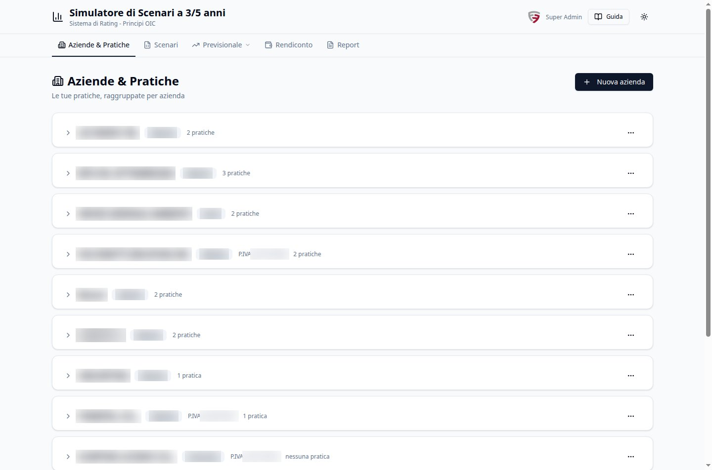

**Che cosa c'è a schermo**

- Intestazione **«Aziende & Pratiche»** e pulsante **«Nuova azienda»**.
- Una **scheda per azienda**: freccia per espandere, nome, settore, partita IVA, numero di
  pratiche, e un menu «…» a destra.
- In alto a destra il pulsante **«Guida»** e il tema chiaro/scuro.

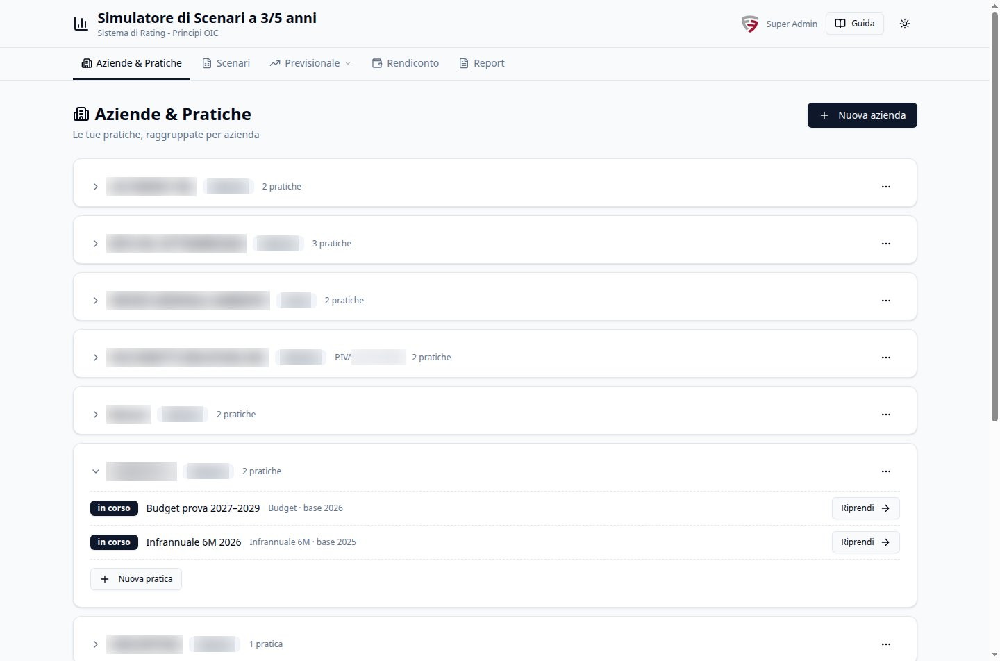

**Espandendo la scheda** compaiono le pratiche dell'azienda: per ciascuna lo stato («in corso»
quando il previsionale è già calcolato, altrimenti «bozza»), il nome, il tipo e l'anno base
(«Budget · base 2026», «Infrannuale 6M · base 2025») e **«Riprendi»**, che riparte dall'ultimo
passaggio raggiunto. In fondo c'è **«Nuova pratica»**.

La cache di dove eri sta nel tuo browser, ma `/pratica` la riverifica col server all'apertura.
Se la pratica infrannuale non si ritrova più, la pagina mostra il banner **«Pratica da
riaprire»** e ti fa ripartire dall'importazione o dalla home (§ Che cosa succede quando qualcosa
non torna). Una pratica nata direttamente come budget, senza un infrannuale dietro, si apre
invece sulla sola fase PREVISIONALE.

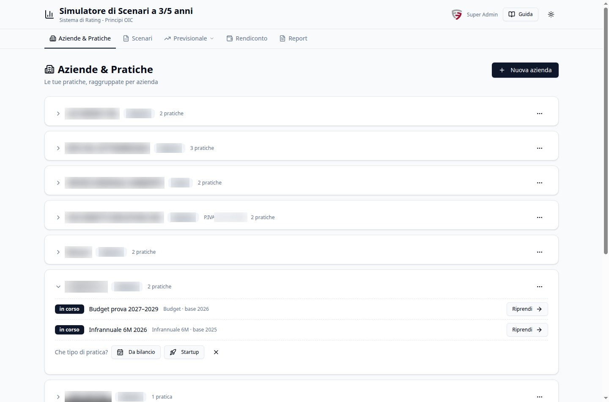

**«Nuova pratica»** apre, dentro la scheda, la riga **«Che tipo di pratica?»** con la scelta fra
**Da bilancio** (importi un bilancio, anche solo di verifica, e poi analizzi) e **Startup**
(nessun bilancio, solo ipotesi; § 13). Se l'azienda ha già un bilancio annuale importato,
«Da bilancio» chiede ancora **«Da quale bilancio?»**:

- **«Nuovo bilancio»** apre il percorso completo, dall'Import;
- **«Bilancio esistente»** ti fa scegliere il bilancio annuale già in archivio, chiede il
  **«Nome della nuova pratica»** e con **«Crea budget»** apre direttamente il wizard del
  previsionale su quell'anno base, senza ripassare da DATI e ANALISI.

**«Nuova azienda»** apre in testa all'elenco la scheda **«Nuova Azienda»** con **Nome\***,
**Partita IVA** e **Settore\*** a tendina, e il pulsante **«Crea»**; subito dopo l'app chiede il
tipo di pratica. Il settore è a tendina: le sei descrizioni sono lunghe (per esempio «1. Industria, Alberghi (Proprietari),
Agricoltura, Pesca») e se l'azienda è mista fa fede il settore del fatturato principale. Il
settore non è un'etichetta: sceglie il modello Altman (settore 1 a 5 componenti, settori 2-6 a
4) e le soglie FGPMI.

> La home non ha barra di ricerca né ordinamento: le aziende sono solo schede in elenco.

---

# FASE 1 · DATI

## 1. Anagrafica

`/pratica` → tab *Anagrafiche*

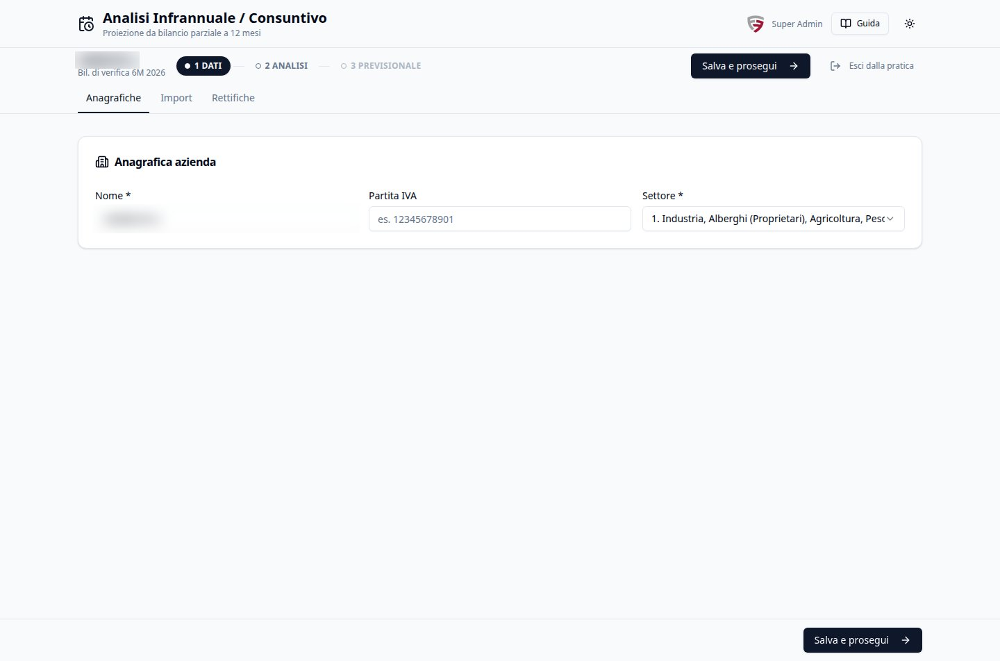

**A che cosa serve.** La carta d'identità dell'azienda su cui stai lavorando: verifichi di
essere sull'azienda giusta e correggi quello che l'import ha letto male.

**Che cosa c'è a schermo**

- **«Nome \*»**, **«Partita IVA»**, **«Settore \*»** a tendina —
  tutti modificabili.
- **«Salva e prosegui»** in basso a destra.

**Come si fa.** 1) correggi nome o partita IVA se l'import le ha sbagliate; 2) imposta il
settore giusto (se non sai quale, scegli quello del fatturato principale); 3) «Salva e prosegui».

**Esempio.** L'azienda di prova è classificata **industria** (settore 1): il suo rating userà le soglie
FGPMI del settore 1 e il modello Altman a 5 componenti.

**Approfondisci** → [PRATICA-PERCORSO.md](frontend/PRATICA-PERCORSO.md)

## 2. Import

`/pratica` → tab *Import* (esiste anche una pagina autonoma `/import`, non collegata alla
navigazione: la via normale è questa tab)

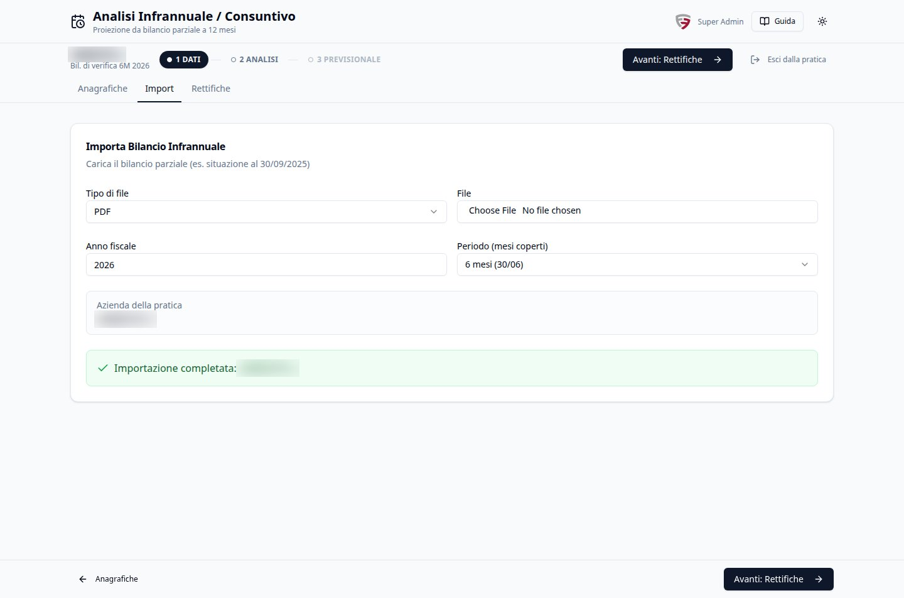

**Che cosa c'è a schermo**

- Il tipo di file: **PDF** (anche i PDF-scansione, dove l'OCR è attivo) o **XBRL**.
- L'azienda e **l'anno** di competenza, e la scelta del periodo: **anno intero** oppure
  **parziale da 1 a 11 mesi** (per esempio 6 = primo semestre). È la scelta che apre la strada
  all'infrannuale.
- Il pulsante **«Importa e Continua»**.

**Come si fa.** 1) scegli tipo file, anno e periodo; 2) scegli il file e premi «Importa e
Continua»; 3) se l'import riesce, l'app passa da sola alle **Rettifiche**: lì trovi la verifica
di quadratura. Se il bilancio non quadra viene **importato comunque**, con il riquadro
«SBILANCIATO», non «aggiustato» in silenzio: si corregge in Rettifiche.

Due casi ti fermano invece sull'Import:

- **Manca l'anno di riferimento.** Se il documento non contiene anche l'anno precedente, compare
  il riquadro **«Serve il bilancio storico …»**: importalo con **«Importa …»**, oppure
  **«Prosegui senza l'anno precedente (solo annualizzazione)»**.
- **File rifiutato.** Il riquadro rosso **«Il file non è stato importato»** dice il motivo e,
  quando può, **«Che cosa caricare»** al suo posto.

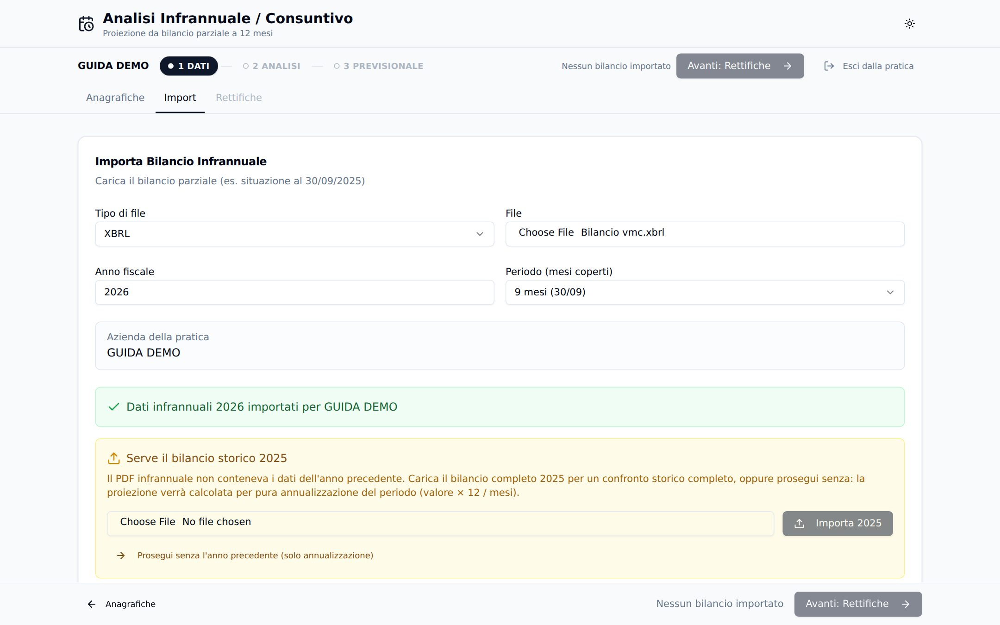

Fuori dal percorso c'è anche la pagina autonoma `/import`, non collegata alla navigazione. Ha una
forma diversa: importa solo **anni interi**, accetta anche il **CSV** (formato TEBE) e mostra gli
avvisi della lettura del PDF.

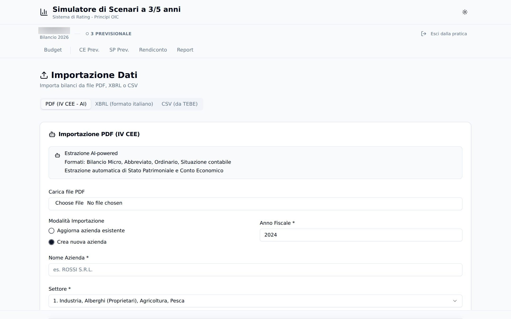

**Che cosa dichiara l'esito.** Attivo = passivo, il totale di CE che quadra con l'utile in
stato patrimoniale, e gli scarti **misurati e non tappati** (un divario fra aggregato e dettagli,
una riga non riconosciuta): tutto diventa riga da correggere in Rettifiche, mai un importo
inventato. Un **parziale** e un **annuale** dello stesso anno coesistono di proposito: gli
schermi che leggono lo storico (l'anno base del previsionale) danno precedenza
all'annuale, il percorso infrannuale (Confronto, Proiezione) lavora sul parziale. Non devi
cancellare l'uno per importare l'altro.

**Attenzione a**

- Un file che non è un bilancio (un riepilogo di poche righe, un foglio export) viene
  **rifiutato** con il riquadro «Il file non è stato importato»: è il comportamento giusto, non
  un guasto.
- Se un PDF dà un risultato strano, riprova l'import; se resta strano, correggi in Rettifiche.

**Approfondisci** → [REGOLE-IMPORT-00-INDICE.md](import/REGOLE-IMPORT-00-INDICE.md)

## 3. Rettifiche

`/pratica` → tab *Rettifiche* — una scheda **per anno** (storico + bilancio di verifica), da
confermare prima di proseguire

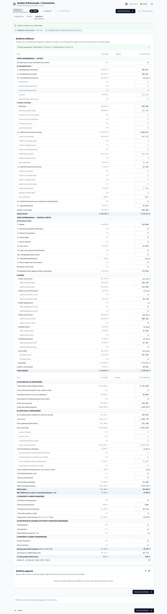

**A che cosa serve.** È l'unico posto dove **tu** correggi i numeri importati. Tutto ciò che sta
a valle legge il giornale: l'app non ha una «versione sistemata» nascosta da qualche parte.

**Che cosa c'è a schermo**

- Le schede per anno, ognuna con l'etichetta «confermata» o «da confermare», e sopra la riga di
  stato («Restano 2 schede da confermare: servono entrambe per proseguire.» oppure «Tutte le
  schede sono confermate.»).
- **«Conferma e vai al Confronto»** nella barra: conferma insieme le due schede e sblocca il resto
  del percorso. Dopo la conferma diventa «Vai al Confronto». In fondo a ogni scheda, **«Passa al
  Confronto»** apre il riepilogo delle modifiche con «Torna alle Rettifiche» e «Conferma e
  Prosegui». Finché non hai confermato, sotto compare *«Conferma le rettifiche per sbloccare gli
  step successivi. Se il bilancio non quadra puoi confermare lo stesso: l'avviso resta.»*
- Le griglie SP e CE con la colonna **Rett.** (il giornale applicato) e il totale live con la
  **verifica di quadratura**. Se il foglio non pareggia compare «SBILANCIATO» con il pulsante
  **«Chiudi sbilancio»**, che propone la rettifica per chiudere la differenza.
- Il riquadro **«Quadratura iniziale»**, quando l'utile importato comprende risultati di esercizi
  precedenti non ancora destinati: **«Spacchetta utile»** li sposta fuori dall'utile
  dell'esercizio. Non conta nel giornale né nel tetto delle 30 rettifiche.
- Il dialogo **«Registra Rettifica»** con tre modalità — **«Rettifica (SP ↔ CE)»**,
  **«Riclassifica (stessa sezione)»**, **«Correggi Import»** — la riga modificata con il suo
  **+importo**, la **contropartita** a tendina e l'importo su di essa, e il conteggio
  «Rettifiche registrate: N / 30». Quando la contropartita sono le immobilizzazioni e l'import ne
  ha il dettaglio, una seconda tendina chiede la sotto-voce. In «Correggi Import» il dialogo si
  chiama «Correggi Importazione» e il pulsante «Applica correzione».

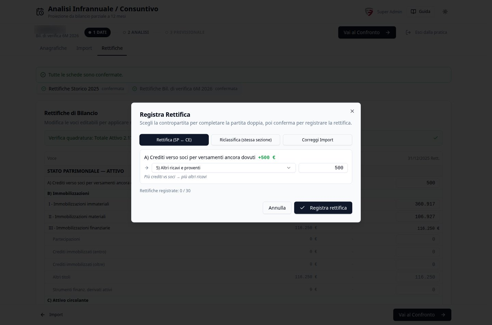

**Esempio.** La figura mostra una rettifica in partita doppia pronta da registrare: +500 € su
«Crediti verso soci per versamenti ancora dovuti», contropartita «Altri ricavi e proventi» 500 €.
Il dialogo stesso riassume il movimento («Più crediti vs soci → più altri ricavi»): dare e avere
sono lo stesso importo e il bilancio quadra come prima; ma qui la contropartita sta nel **CE**,
e con 500 € di altri ricavi si muovono anche il risultato d'esercizio e il patrimonio netto.
È il movimento giusto per un componente mai registrato (la più comune: una fattura da ricevere
non registrata, servizi ↔ debiti verso fornitori). Se vuoi solo spostare una voce senza toccare
i totali c'è **«Riclassifica (stessa sezione)»**: muovi una voce fra due voci della stessa sezione; **«Correggi Import»** è la partita semplice (un campo solo) per errori
dell'importatore.

**Attenzione a**

- **Massimo 30 rettifiche** per giornale: *«Massimo 30 rettifiche. Eliminane qualcuna per
  aggiungerne altre.»*
- Il server **rifiuta una rettifica che peggiora** sbilancio, identità CE↔utile o coerenza
  aggregati/dettagli; se invece il file era già storto dall'import, la correzione passa.
- I campi-aggregato (i totali) non sono editabili: si correggono i dettagli e il totale si
  ricostruisce da loro.

**Approfondisci** → [RETTIFICHE.md](frontend/RETTIFICHE.md)

---

# FASE 2 · ANALISI

Si raggiunge con le Rettifiche confermate, **anche con un bilancio annuale**: le tab Confronto,
Indicatori e Stampa ci sono sempre. La tab **Proiezione** compare solo con un **periodo
parziale** (< 12 mesi) importato: è l'analisi del «non ancora chiuso», il parziale proiettato a
12 mesi contro l'ultimo anno pieno.

## 4. Confronto

`/pratica` → tab *Confronto*

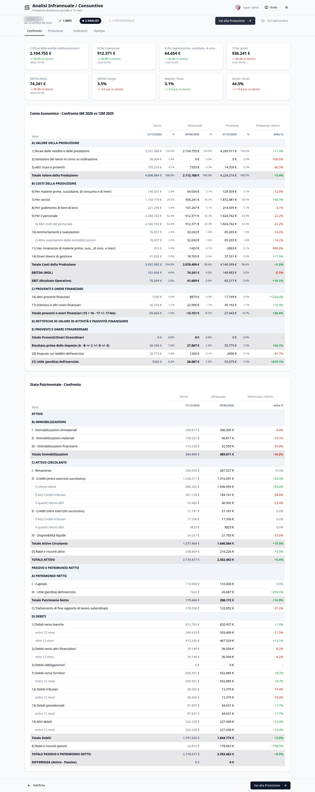

**A che cosa serve.** Righe accanto: il parziale contro l'anno di riferimento, con le variazioni.
È la lettura preliminare, **di sola lettura**.

**Che cosa c'è a schermo**

- In testa, le schede con i numeri principali del confronto.
- Il **«Conto Economico - Confronto»** (per esempio «6M 2026 vs 12M 2025»): l'anno di
  riferimento, il periodo e la sua annualizzazione (il periodo × 12 / mesi), riga per riga, con
  la variazione %.
- Lo **«Stato Patrimoniale - Confronto»**: un'istantanea a fine periodo, **non annualizzata** —
  è una fotografia, non un flusso.

**Esempio (figura).** Ricavi: **2.104.755 €** nei 6 mesi al 30/06/2026 diventano **4.209.510 €**,
che è il loro × 12 / 6; contro i 3.761.088 € del 2025 fa **+11.9%** nella colonna «delta %». È
quella variazione il punto da cui parte la proiezione.

**Come si fa.** 1) guardi dove il periodo corre più dell'anno di riferimento (ricavi, costo del
personale, EBITDA); 2) le percentuali che vedi qui sono le stesse che il motore userà per la
proiezione — ma per cambiarle non sei qui: si cambiano in **Proiezione**.

**Approfondisci** → [REGOLE-IMPORT-05-INFRANNUALE.md](import/REGOLE-IMPORT-05-INFRANNUALE.md)

## 5. Proiezione

`/pratica` → tab *Proiezione*

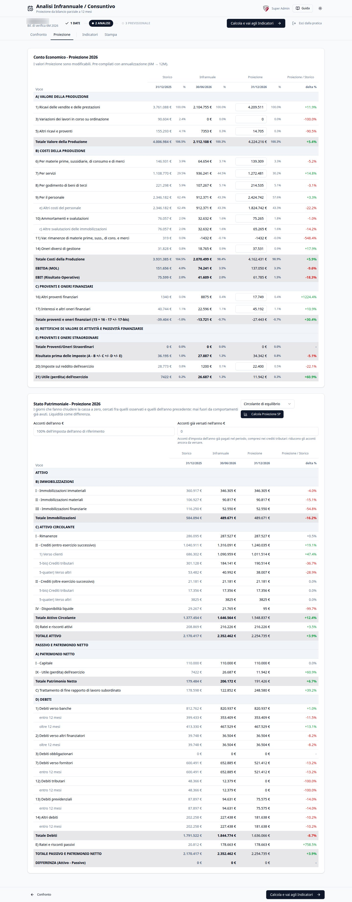

**A che cosa serve.** Qui il parziale diventa anno pieno: 21 voci di conto economico che puoi
digitare a mano (le due variazioni di magazzino le calcola il motore), e uno stato patrimoniale
proiettato che **il server** adatta di conseguenza.

**Che cosa c'è a schermo**

- La griglia CE modificabile con i subtotali che si aggiornano mentre digiti (valore della
  produzione, costi, MOL, EBIT, risultato ante e post imposte, utile).
- Sopra lo stato patrimoniale proiettato, la tendina del circolante: **«Circolante storico»** (i
  giorni dell'anno di riferimento, il default), **«Circolante infrannuale»** (i giorni osservati
  nel periodo), **«Circolante di equilibrio»** (cerca i giorni che chiudono la cassa a zero).
- Le imposte dell'anno: **«Acconti dell'anno €»** (vuoto = il 100% dell'imposta dell'anno di
  riferimento) e **«Acconti già versati nell'anno €»**, la parte degli acconti già pagata nel
  periodo e compresa nei crediti tributari.
- **«Calcola Proiezione SP»**: salva le ipotesi, fa rigenerare il motore e rilegge. Il pulsante
  della barra, **«Calcola e vai agli Indicatori»**, fa lo stesso e passa alla tab dopo. Non c'è un
  secondo calcolatore a schermo: proiezione, indicatori e stampa leggono **lo stesso risultato**.
- Lo stato patrimoniale proiettato. Se attivo e passivo non pareggiano, un riquadro ambra dice
  che la differenza è il **fabbisogno finanziario non coperto**.

**Esempio (figura).** Nella colonna 31/12/2026 alcune celle sono digitate a mano: le imposte
forzate a **32.000 €**, gli oneri diversi a 37.530 €. I sottototali si ricompongono
live — totale costi della produzione **4.249.644 €**, EBITDA **165.836 €**, risultato prima
delle imposte 60.130 €, utile **28.130 €** — e sotto lo stato patrimoniale si adatta, con la
cassa che chiude il foglio.

**Attenzione a**

- Gli ammortamenti sono **annualizzati**, mai «cresciuti».
- Il debito finanziario viene riportato dal parziale così com'è: **non ruota** coi ricavi; solo
  il residuo operativo ruota sui ratio dell'anno di riferimento.
- Un fabbisogno di cassa scoperto qui **non** blocca la proiezione: esce come diagnosi di errore
  e lo scenario non è promuovibile finché non aggiungi una copertura (ipotesi o rettifica).

**Approfondisci** → [REGOLE-IMPORT-05-INFRANNUALE.md](import/REGOLE-IMPORT-05-INFRANNUALE.md) §5-bis

## 6. Indicatori

`/pratica` → tab *Indicatori*

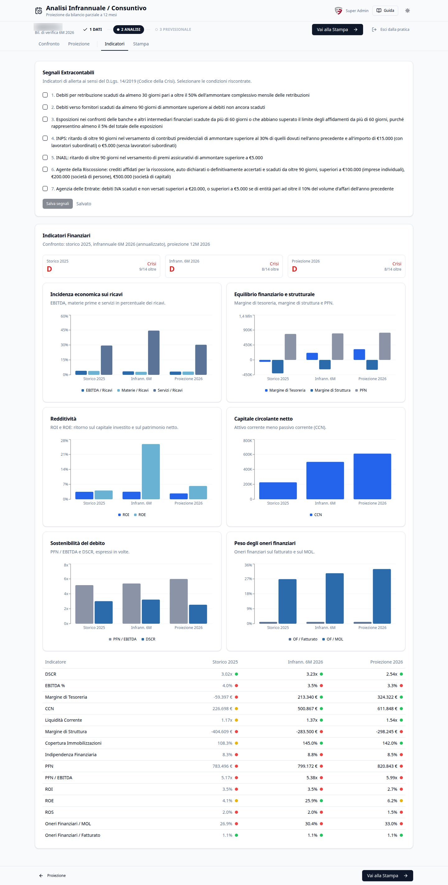

**A che cosa serve.** Gli indicatori della crisi d'impresa sull'anno di riferimento, sul periodo
annualizzato e sulla proiezione, con la classe di rischio.

**Che cosa c'è a schermo**

- **«Segnali Extracontabili»**: sette caselle da spuntare, una per ciascun segnale di allarme
  previsto dal Codice della crisi (debiti scaduti verso dipendenti, fornitori, banche e così via) e **«Salva segnali»**.
- **«Indicatori Finanziari»**: sei grafici e la tabella dei **15 indicatori della crisi** sulle
  colonne Storico, Infrannuale e Proiezione. 14 concorrono al punteggio, l'ultimo (incidenza degli
  oneri finanziari sui ricavi) è informativo. I grafici sono lo stesso componente della Stampa.
- **«Calcola Rating»**: colora gli indicatori di verde, ambra o rosso e mostra le schede con la
  classe (A3→D) di ogni colonna. Se non hai spuntato alcun segnale, l'app chiede prima di
  confermare che non ce ne sono. Indicatori, punteggio e classe li calcola il server.

Con un bilancio di **12 mesi** non c'è la tab Proiezione: gli Indicatori generano l'anno da soli
e, se il motore lo rifiuta, mostrano il motivo con «Riprova».

**Esempio (figura).** **PFN/EBITDA: 5.17x** sullo storico e 5.38x sul semestre annualizzato,
**1.65x** sulla proiezione. È il numero che pesa di più nel punteggio: il debito finanziario
netto vale più di cinque anni di margine lordo, e scende sotto due solo se il piano tiene.

**Formule, soglie e classe di rischio** → [Le formule dei report](#il-report-infrannuale)

**Approfondisci** → [INDICATORI-E-STAMPA.md](frontend/INDICATORI-E-STAMPA.md)

## 7. Stampa

`/pratica` → tab *Stampa*

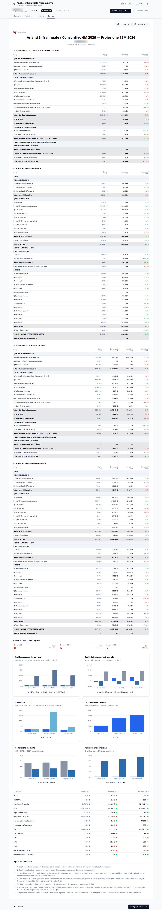

**A che cosa serve.** Il documento infrannuale vero: 13 pagine con copertina e indice (sintesi,
CE, costi, SP, circolante, debito, crisi d'impresa, segnali, allegati A/B), generato dal server.

**Che cosa c'è a schermo**

- L'anteprima a schermo di tabelle, indicatori e grafici. I commenti ai numeri non sono qui:
  stanno nel report PDF e Word.
- In alto a destra, **«Prosegui al Budget»**: crea lo scenario con l'anno di questa pratica (o
  riprende quello già creato) e apre il wizard (§ 8); su un periodo parziale promuove prima la
  proiezione a bilancio annuale.
- **«Scarica PDF»** — il pulsante che conta: produce lo stesso documento del server, non la
  pagina del browser. **«Scarica Word»** esporta lo stesso report in `.docx` per ritoccare i testi.

**Attenzione a**

- La stampa del browser è un'anteprima: per consegnare il documento usa «Scarica PDF».

**Formule** → [Le formule dei report › Il report infrannuale](#il-report-infrannuale)

**Approfondisci** → [REPORT-INFRANNUALE-PDF.md](budget/REPORT-INFRANNUALE-PDF.md)

---

# FASE 3 · PREVISIONALE

Le tab dentro la pratica sono cinque: **Budget** (il wizard), **CE Prev.**, **SP Prev.**,
**Rendiconto**, **Report**. Fuori da una pratica, la barra in alto ha **«Scenari»** (la lista degli
scenari budget), il menu **«Previsionale»** con CE e SP Previsionale, **«Rendiconto»** e
**«Report»**.

## 8. Il wizard in 7 passi

`/budget` — la tab *Budget* della pratica, o «Scenari» nella barra in alto. Lo scenario nasce
dalla pratica («Prosegui al Budget» nella Stampa, oppure «Bilancio esistente» → «Crea budget»
dalla home); sulla scheda di uno scenario ci sono **«Modifica»**, **«Ricalcola»**, **«Nuovo
piano da questa base»** ed **«Elimina»**. Il wizard si riapre sul passo dove avevi lasciato lo
scenario (la prima volta dal passo 1); i sette passi stanno in alto: Scenario · Fatturato · Costi
· Capitale circolante · Patrimoniale pregresso · Patrimoniale piano · Imposte.

**Come funziona un passo.** A sinistra le ipotesi, a destra l'**anteprima dal vivo**: il pannello
del motore che si aggiorna mentre digiti e **non scrive nulla**. Il pulsante in basso è
**«Avanti»** fino al passo 6; al passo 7 diventa **«Salva e calcola previsionale»**. Niente di ciò
che tocchi esiste per il server finché non lo premi.

### Passo 1 · Scenario

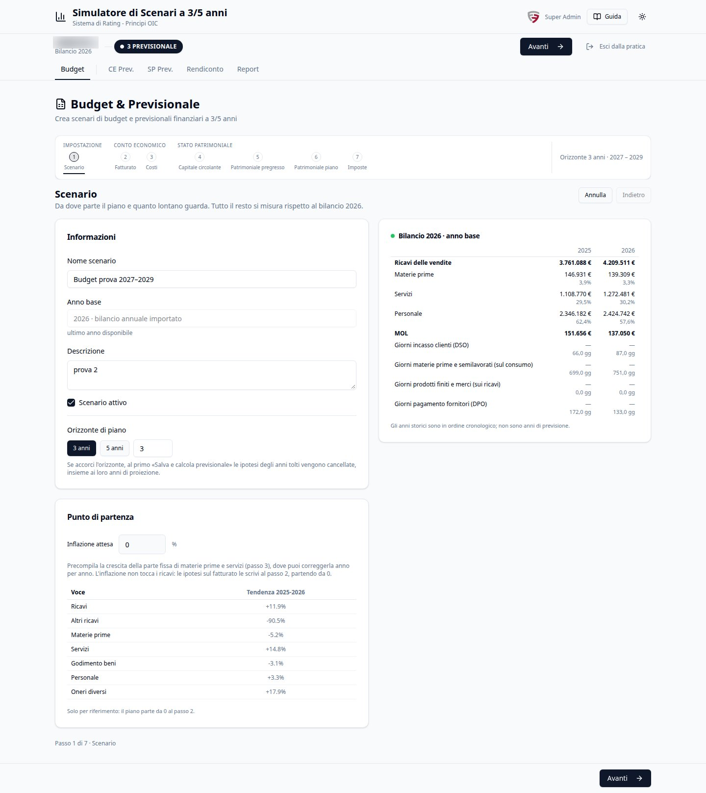

**Che cosa c'è a schermo**

- **«Nome scenario»**, la **«Descrizione»**, la casella **«Scenario attivo»**, l'**anno base** — non è a scelta: un campo non modificabile con l'ultimo bilancio
  annuale importato («2026 · bilancio annuale importato», fra l'altro segnato «ultimo anno
  disponibile») — e l'orizzonte: **«3 anni» / «5 anni»** più il campo numerico.
- Il riquadro **«Punto di partenza»** con **«Inflazione attesa»** e la tabella **«Tendenza»**,
  che per ricavi, altri ricavi, materie prime, servizi, godimento beni di terzi, personale e
  oneri diversi mostra la variazione % fra gli ultimi due anni annuali.
- A destra, il riepilogo dell'anno base con i giorni storici (DSO/DIO/DPO) e la struttura dei
  costi: è da qui che il motore parte.

**Che cosa fa l'inflazione.** **Non tocca i ricavi.** Precompila la crescita della sola **parte
fissa** di materie prime e servizi al passo 3 (puoi correggerla lì).

**Attenzione a.** Accorciare l'orizzonte non lascia anni fantasma: già al primo «Salva e calcola
previsionale» le ipotesi degli anni tolti vengono cancellate, insieme ai loro anni di
proiezione — la schermata lo avvisa con queste parole.

### Passo 2 · Fatturato

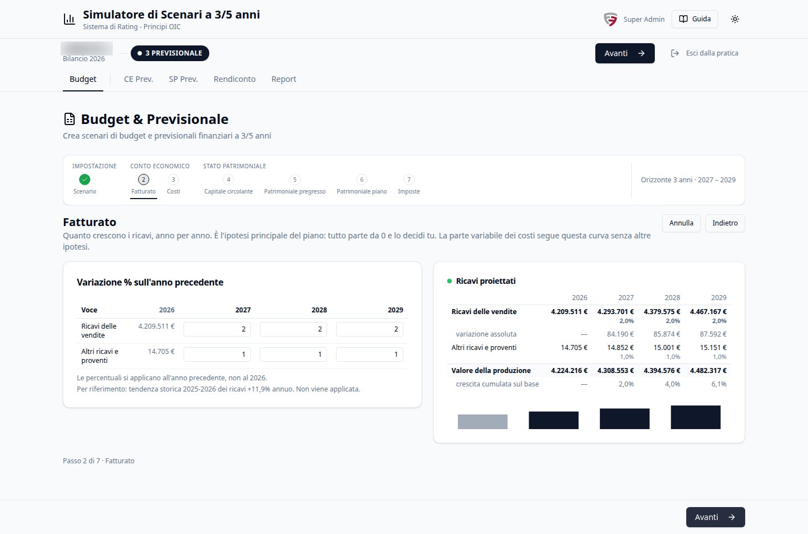

**Che cosa c'è a schermo**

- Il riquadro **«Variazione % sull'anno precedente»**: una riga **«Ricavi delle vendite»** e una
  **«Altri ricavi e proventi»** per ogni anno di piano — «Le percentuali si applicano all'anno
  precedente, non al 2026».
- A destra l'anteprima **«Ricavi proiettati»**: riga per riga, con la barra dei ricavi.

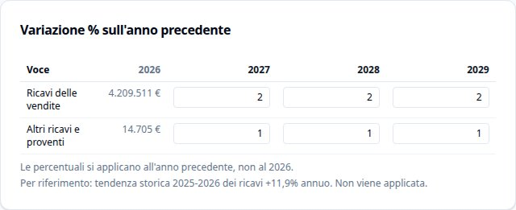

**Esempio (azienda di prova, ricavi 2026 = 4.109.510 €).** Con +5% nel 2027 l'anteprima dà ricavi
**4.314.986 €** (+205.476 €); portando quella cella a +7,5% diventano **4.417.723 €**
(+308.213 €) e tutto il resto del piano si riposiziona: la crescita si compone anno su anno,
quindi il +6% del 2028 lavora sui 4,42 milioni nuovi, non sui 4,31 vecchi.

**Attenzione a.** Qui una cella vuota vale zero, cioè ricavi fermi all'anno prima. Se la riga è
stata forzata in **CE Previsionale** (§ 9), sotto la tabella compare
«prevale l'importo fissato in CE Prev.; la percentuale non viene applicata»: lì la crescita non
fa nulla finché non liberi l'override (pulsante «Usa la percentuale»).

### Passo 3 · Costi

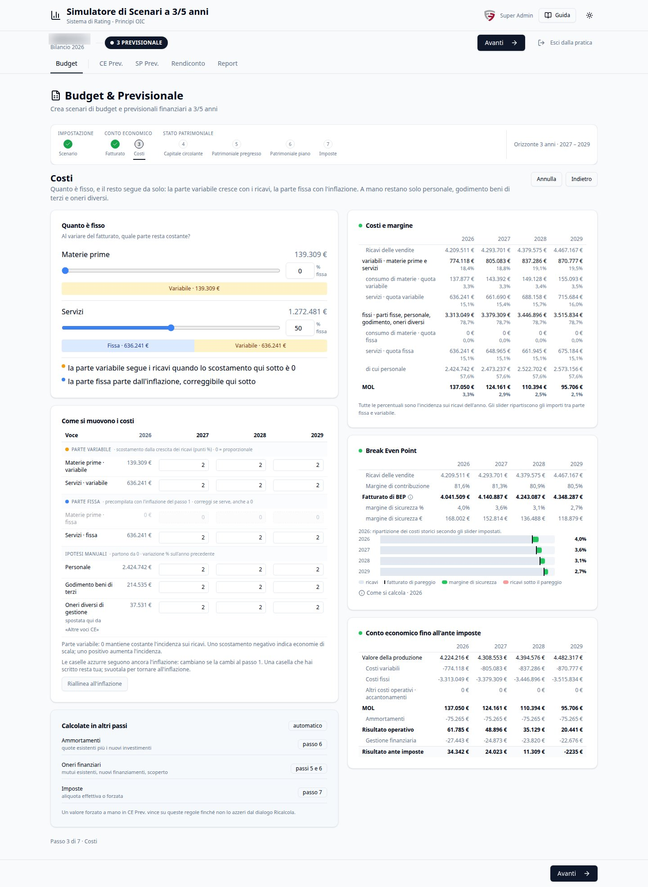

**Che cosa c'è a schermo**

- **«Quanto è fisso»**: per **Materie prime** e **Servizi** uno slider con la % fissa e la barra
  che mostra i due importi.
- **«Come si muovono i costi»**: la tabella **«Parte variabile»** (scostamento dalla crescita dei
  ricavi in punti %, 0 = proporzionale), la **«Parte fissa»** (precompilata con l'inflazione del
  passo 1) e le **«Ipotesi manuali»** — Personale, Godimento beni di terzi, Oneri diversi — con
  la variazione % per anno. Il pulsante **«Riallinea all'inflazione»** rimette
  la parte fissa sul valore dell'inflazione.
- **«Calcolate in altri passi»**: ammortamenti (passo 6), oneri finanziari (passi 5 e 6),
  imposte (passo 7) — qui non si toccano.
- A destra tre anteprime: **«Costi e margine»** (ricavi, costi variabili e fissi riga per riga),
  **«Break Even Point»** (il pareggio anno per anno, con le stesse formule del Business plan: vedi
  [Il break even point](#il-break-even-point)) e **«Conto economico fino all'ante imposte»**.

Per le materie prime la quota fissa e variabile riguarda il **consumo di materie** (acquisti +
variazione delle rimanenze di materie), non i soli acquisti: nelle anteprime le righe si chiamano
«consumo di materie · quota fissa» e «consumo di materie · quota variabile». Gli acquisti sono il
risultato: consumo più rimanenze finali meno iniziali.

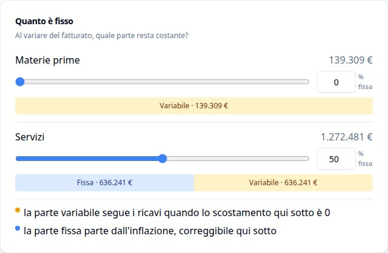

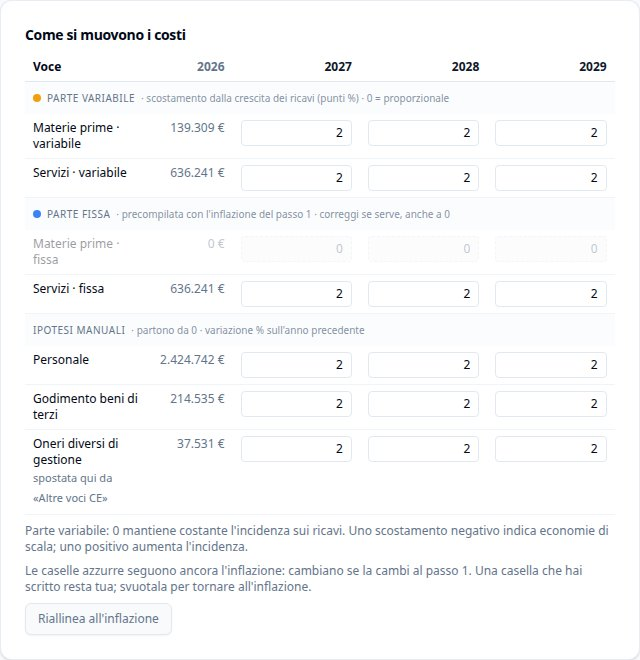

**Esempio (servizi 2026 = 1.432.482 €, quota fissa salvata 50%).** Con il 50% l'anteprima dà
«servizi · quota variabile» 2027 = **752.053 €** e il totale variabile (materie + servizi)
**887.826 €** (consumo di materie + servizi), il 20,6% dei ricavi. Alzando lo slider a **100%** la parte variabile dei servizi
va a zero: la quota variabile scende a **0 €** e il totale variabile 2027 a **135.773 €**
(3,1%) — tutto il costo dei servizi cresce ora con l'inflazione, non più coi ricavi. È la leva
giusta per capire quanto il margine del piano dipende dal volume.

**Attenzione a.** La % fissa è **una sola e vale per tutti gli anni** (il modello è per anno,
l'interfaccia no): se uno scenario ha valori diversi fra anni la schermata avvisa e allinea al
primo tocco. Un valore forzato a mano in CE Prev. (§ 9) vince su tutte queste regole finché non
lo azeri dal dialogo Ricalcola.

**Approfondisci** → [FORECASTING_GUIDE.md](budget/FORECASTING_GUIDE.md)

### Passo 4 · Capitale circolante

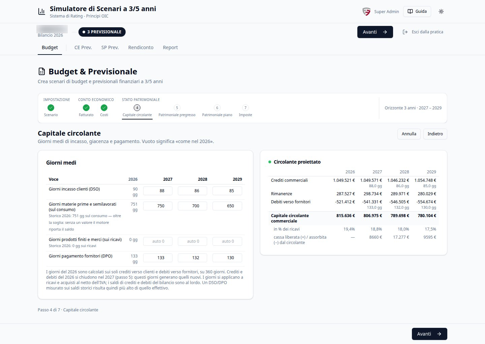

**Che cosa c'è a schermo**

- **«Giorni medi»** per anno: **DSO** (incasso clienti), **DIO** in due gruppi —
  materie/semilavorati (sul consumo) e prodotti finiti/merci (sui ricavi) — **DPO** (pagamento
  fornitori): quattro righe, una colonna per anno di piano; le altre voci minori sono governate
  dai passi 5 e 6, non dai giorni.
- L'anteprima **«Circolante proiettato»**: crediti commerciali, rimanenze, debiti verso
  fornitori, capitale circolante commerciale e — la riga che interessa — **«cassa liberata (+) /
  assorbita (−) dal circolante»**.

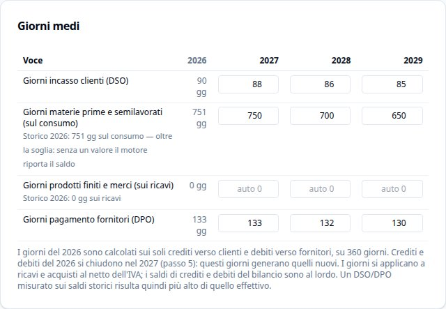

**Esempio (DSO 2027: da 96 a 60 giorni).** Il 96 è l'ipotesi salvata: la colonna 2026 mostra
il valore **derivato** dall'anno base (97 gg) e una cella vuota ricade su di esso. I crediti
commerciali 2027 passano da **1.155.663 €**
a **724.164 €**, la «cassa liberata» 2027 da +227.248 € a **+658.747 €**. Ma attenzione al 2028:
i giorni 2028 restano 95 e l'incasso straordinario del 2027 si **rovescia** in un assorbimento di
**−458.688 €**. Un giorno medio modificato in un solo anno è una decisione *una tantum*, non una
politica di cassa: se vuoi che duri, metti gli stessi giorni su tutti gli anni.

**Attenzione a.** I giorni che scrivi si applicano così come sono, anche oltre 365. Se lasci la
cella vuota, il motore deduce i giorni dall'anno base; se quel calcolo ha un denominatore non
positivo (ricavi o consumi a zero) o dà oltre un anno di rotazione, il valore è **scartato**: il
motore riporta lo stock dell'anno base e l'anteprima lo dichiara con l'avviso. Per il magazzino
di immobiliare ed edilizia (settori 5 e 6) la soglia è più alta, perché lì uno stock di più anni
è normale. Quando i giorni scritti spostano molto il magazzino, l'anteprima lo segnala come
«acquisti in meno (o in più), a parità di consumo»: il numero resta il tuo.

### Passo 5 · Patrimoniale pregresso

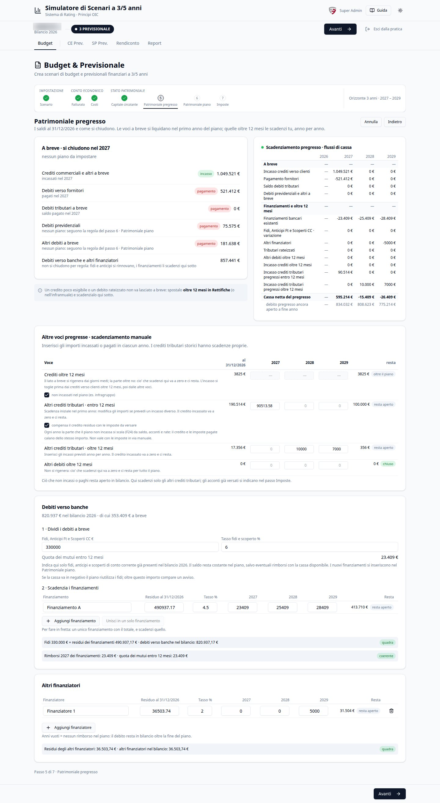

**A che cosa serve.** Che fine fanno i saldi **già in bilancio al 31/12 dell'anno base**: il
lato breve si chiude nel primo anno di piano, quello oltre 12 mesi lo scadenzi tu.

**Che cosa c'è a schermo**

- **«A breve · si chiudono nel 2027»**: crediti commerciali, fornitori e tributari a breve si
  incassano o pagano nel primo anno di piano. Debiti previdenziali e altri debiti a breve si
  chiudono solo se dai loro un piano; senza, «seguono la regola del passo 6 · Patrimoniale piano».
  I debiti verso banche e altri finanziatori non si chiudono per regola: hanno le loro schede,
  sotto.
- **«Altre voci pregresse · scadenziamento manuale»**: sempre **«Crediti oltre 12 mesi»** e
  **«Altri debiti oltre 12 mesi»**; le altre righe compaiono solo se l'anno base ha quel saldo
  (altri crediti tributari entro e oltre 12 mesi, debiti fornitori e previdenziali oltre 12 mesi,
  **«Debiti tributari rateizzati»**). Per ognuna una casella per anno, il «resta» e lo stato
  («resta aperto», «chiuso», «oltre il saldo»…). Sotto la riga tributaria a breve c'è la casella
  **«compensa il credito residuo con le imposte da versare»**.
- A destra l'anteprima **«Scadenziamento pregresso · flussi di cassa»**: quanto entra ed esce
  ogni anno per effetto dei piani.
- **«Debiti verso banche»**: «1 · Dividi i debiti a breve» (fidi/anticipi con
  tasso, e la «quota dei mutui entro 12 mesi» che ne deriva) e «2 · Scadenzi i finanziamenti»
  (una riga per finanziamento pregresso: «Residuo al 31/12/2026», tasso, rata per anno, «Resta»
  + «resta aperto»). I due controlli in fondo: *fidi + residui dei finanziamenti = debiti verso banche a
  bilancio* (**quadra**), *rimborsi primo anno = quota mutui entro 12 mesi* (**coerente**).
- **«Altri finanziatori»**, stessa forma.

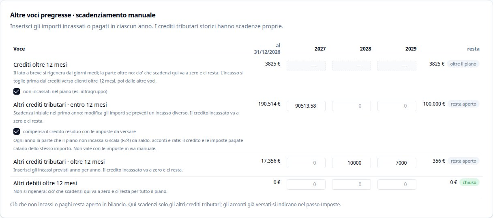

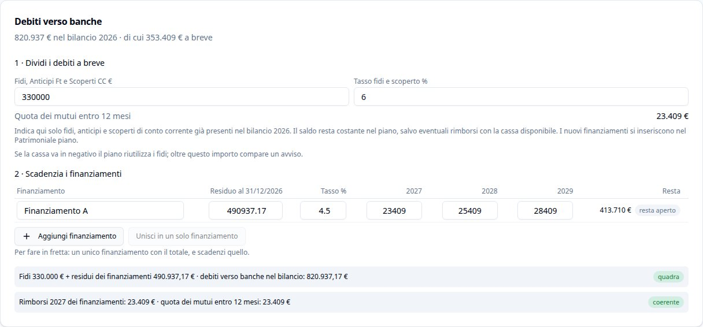

**Esempio (azienda di prova).** Debiti verso banche 2026 = **960.937 €**, «di cui 493.409 € a breve»:
fidi 400.000 € (tasso 6%) + 93.409 € di rate 2027 dei due finanziamenti. Il credito oltre 12
mesi da 45.000 € scadenziato a 5.000 €/anno chiude il piano con **30.000 € «resta aperto»** —
quei 30.000 € restano nello stato patrimoniale a fine piano, e nessun anno di piano li vedrà
scadere.

**Attenzione a.** Un anno forzato in **via manuale** (passo 7, «Posizione tributaria manuale») non può scaricare meno di quanto
il piano tributario ripartirà l'anno dopo, o la stessa rata uscirebbe due volte: il motore lo
rifiuta con un errore che nomina l'anno e le tre vie d'uscita. E un residuo oltre 12 mesi che
non scadenzi **non sparisce**: resta in bilancio per tutto il piano.

**Approfondisci** → [API-PREVISIONALE.md](budget/API-PREVISIONALE.md)

### Passo 6 · Patrimoniale piano

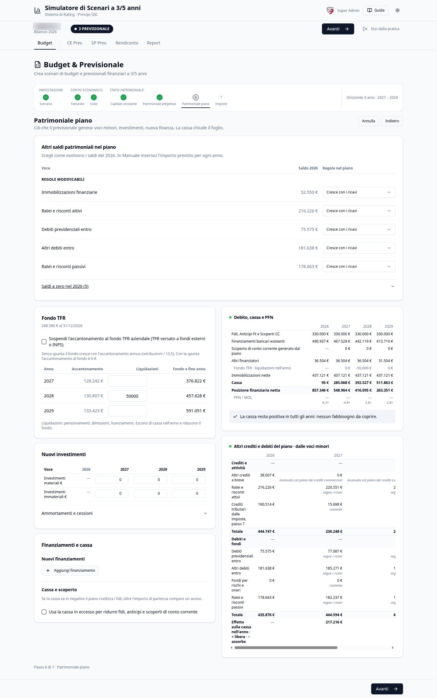

**A che cosa serve.** Che cosa il piano **genera**: investimenti, nuovi finanziamenti, fondo
TFR, altri saldi. La cassa chiude il foglio.

**Che cosa c'è a schermo**

- **«Altri saldi patrimoniali nel piano»**: tendina per voce — *Cresce con i ricavi*, *Cresce
  con gli acquisti (materie e servizi)*, *Cresce con il costo del personale*, oppure *Manuale*
  (e allora compaiono gli importi per anno, con lo storico a sinistra non editabile) — e i
  «Saldi a zero nel 2026» raccoglitore.
- **«Fondo TFR»**: saldo iniziale, casella per sospendere l'accantonamento (TFR a fondi esterni),
  riga per anno: accantonamento (calcolato), **liquidazioni** (le inserisci tu), fondo a fine
  anno. Le liquidazioni **oltre il fondo disponibile si rifiutano**, non si riducono.
- **«Nuovi investimenti»**: importi per anno, materiali e immateriali;
  «Ammortamenti e cessioni» raccoglitore con le aliquote. Un cespite nuovo ammortizza a **metà
  aliquota** nell'anno di entrata.
- **«Finanziamenti e cassa → Nuovi finanziamenti»**: nome, Importo, anno di erogazione, durata,
  preammortamento, tasso. **«Cassa e scoperto»**: «Usa la cassa in eccesso per
  ridurre fidi, anticipi e scoperti di conto corrente» (sweep); spuntata la casella compare
  **«Cash sweep: cassa minima €»**. Che cosa succede se la cassa va in negativo dipende dal
  passo 5:
  - **con fidi dichiarati** (il caso della figura): «Se la cassa va in negativo il piano riutilizza
    i fidi; oltre l'importo di partenza compare un avviso»;
  - **senza fidi**: compare la casella **«Concedi lo scoperto: il fabbisogno scoperto diventa
    debito bancario a breve»**, con il «Tetto dello scoperto €». Non è concesso di default: un
    fabbisogno senza rimedio fa **fallire la generazione** con un errore, invece di inventare un
    numero.

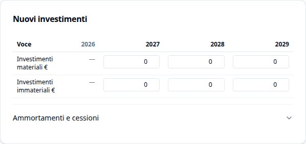

**Esempio (azienda di prova: «Nuova Finanza», 250.000 € erogati nel 2027, 5 anni, tasso 4,5%).** La
scheda stessa dice «rata 50.000 €/anno dal 2027»; nell'anteprima «Debito, cassa e PFN» il nuovo
prestito residua **200.000 €** a fine 2027, 150.000 € nel 2028, 100.000 € nel 2029 — e la rata
che scade l'anno dopo sta **già** dentro i debiti bancari a breve dello SP Prev. (non resta
tutta oltre i 12 mesi: sarebbe un errore che il pareggio attivo = passivo non vede, ma che
falsa circolante e indici di liquidità).

**Approfondisci** → [FORECASTING_GUIDE.md](budget/FORECASTING_GUIDE.md)

### Passo 7 · Imposte

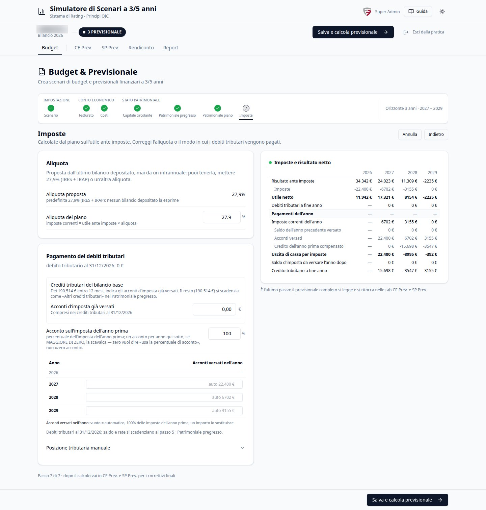

**Che cosa c'è a schermo**

- **«Aliquota»**: proposta dall'**ultimo bilancio annuale depositato** (mai da
  un infrannuale, mai da una proiezione); 27,9 = IRES+IRAP quando non è derivabile o esce sopra
  60. L'aliquota si applica **così com'è**: la cambi tu se la vuoi diversa.
- **«Pagamento dei debiti tributari»**: la regola di cassa — ogni anno si paga
  il **saldo** dell'anno prima + gli **acconti** dell'anno; l'acconto è per default 100%
  dell'imposta dell'anno prima, o l'importo esplicito se **maggiore di zero** (zero nella
  casella = «non dichiarato», e si torna alla percentuale).
- **«Acconti d'imposta già versati»** nel bilancio base (compresi nei crediti tributari) e
  **«Acconto sull'imposta dell'anno prima %»**.
- La sezione chiusa **«Posizione tributaria manuale»**: per forzare debiti e crediti tributari
  anno per anno invece della regola saldo + acconto.
- L'anteprima fiscale: risultato ante imposte, imposte, utile, debiti tributari a fine anno, e i
  **pagamenti dell'anno** riga per riga (saldo versato, acconti, credito compensato, uscita di
  cassa).

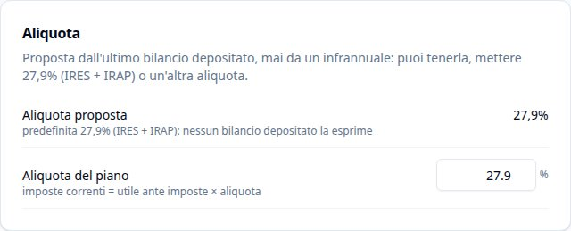

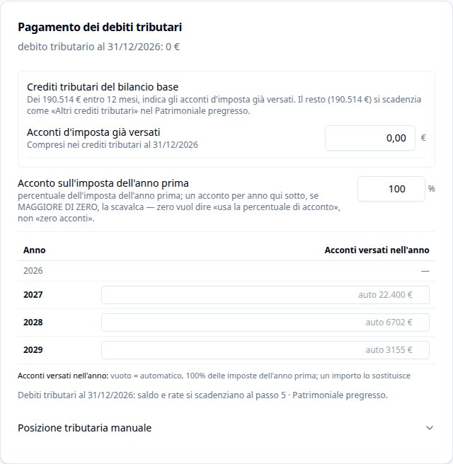

**Esempio (azienda di prova).** Nel 2027 l'uscita di cassa per imposte è **37.227 €**: saldo 2026
**4.227 €** + acconto 2027 **33.000 €**, versati in un colpo solo. Nel 2028 l'uscita è
**−33.000 €**: il primo anno di piano chiude in perdita, quindi non c'è saldo da pagare e
l'acconto versato l'anno prima torna indietro come credito compensato; non a caso l'«acconto
auto» del 2028 in anteprima è **0 €**: l'acconto di default è il 100% dell'imposta dell'anno
prima, e quella del 2027 è zero. Nel 2029 si pagano saldo + acconto del 2028: **109.291 €**. Se
l'aliquota proposta non ti convince la cambi: si applica così com'è.

**Approfondisci** → [API-PREVISIONALE.md](budget/API-PREVISIONALE.md) §4

### Il pulsante finale: «Salva e Calcola Previsionale»

Il salvataggio che produce il previsionale. Due verità che vale sapere:

- Un previsionale **rifiutato** (per esempio: *«Fabbisogno finanziario scoperto di … €:
  aggiungi un'ipotesi di finanziamento esplicita; nessun debito bancario è stato creato
  automaticamente.»*) risponde comunque «ok» al salvataggio: le ipotesi restano
  salvate e **la ragione arriva nel toast** — nel wizard a 7 passi è un errore che ti riporta
  anche al passo che lo ha causato, nel modulo Startup un avviso giallo. Se il toast dice
  «Previsionale calcolato» il calcolo c'è, e l'app ti porta al **CE Previsionale**.
- Dal dialogo **«Ricalcola»** (pulsante omonimo sulla lista scenari) puoi azzerare le modifiche
  manuali del CE: la casella **«Azzera le modifiche manuali del CE previsionale»** cancella solo
  quelle, **non** gli override dello SP Prev.

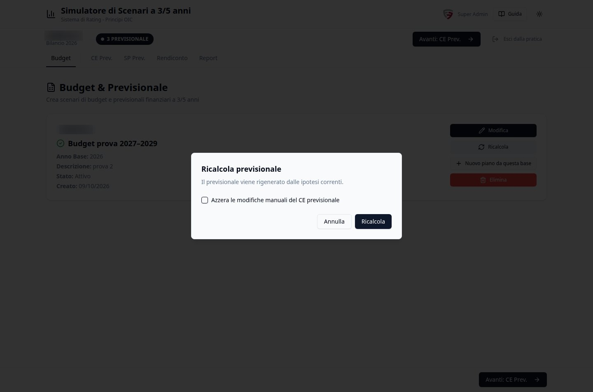

## 9. CE Previsionale

`/forecast/income`

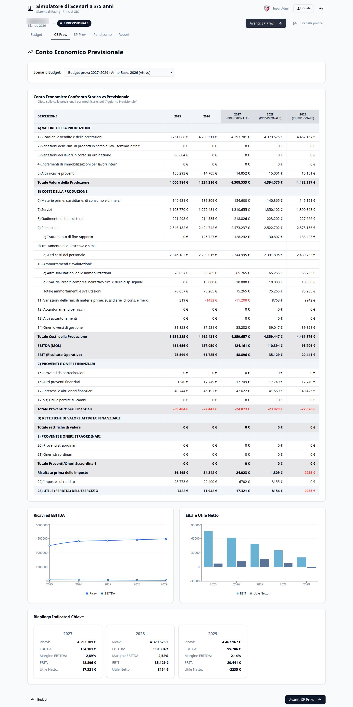

**A che cosa serve.** Guardare e correggere il conto economico di piano **cella per cella**: le
percentuali del wizard sono già diventate importi, e qui puoi forzarli.

**Che cosa c'è a schermo**

- La griglia «Conto Economico: Confronto Storico vs Previsionale»: una colonna per anno, con gli
  anni di piano marcati «(Previsionale)»; *«Clicca sulle celle previsionali per modificarle, poi
  "Aggiorna Previsionale"»*. Il pulsante **«Aggiorna Previsionale»** compare quando hai modifiche
  in sospeso.
- Una cella forzata appare diversa (bordo e freccia) e resta tale anche ricaricando la pagina;
  l'icona accanto la ripristina, **«Ripristina tutte le forzature»** le azzera in blocco.
- Dentro una pratica, il pulsante della barra è «Salva e prosegui: SP Prev.».
- Sotto: ricavi/EBITDA, EBIT/utile, il riepilogo indici per anno.

**Esempio.** Forzando «Ricavi delle vendite» 2027 a **4.500.000 €** (figura sotto), il 2027
diventa 4,5 milioni **e anche il 2028 si muove**: 4.770.000 € = il forzato × la crescita +6%
salvata, e il 2029 a 4.817.700 €. L'override è sopravvissuto a ogni «Salva e Calcola»
successivo: vince sulla percentuale e non si azzera da solo.

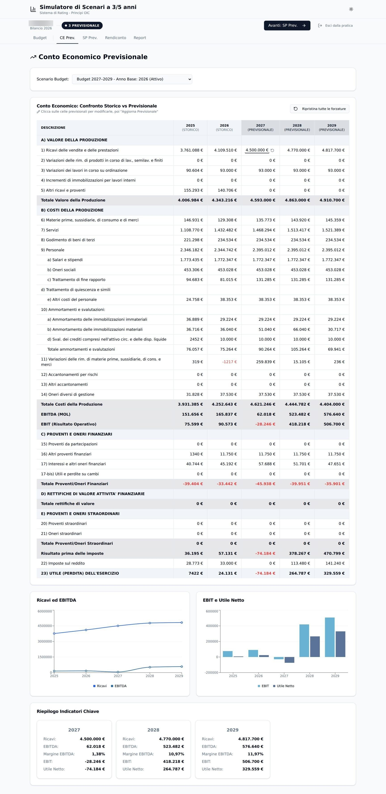

**Attenzione a.** L'override che il motore rifiuta — perché sbilancerebbe il foglio o perché la
riga è governata da un piano — **non viene salvato**: l'errore appare a schermo e la cella torna
com'era. Se il numero non cambia dopo una modifica, prima guarda se c'è un override attivo
altrove: dove la riga è forzata, il wizard (passo 2) lo dice sotto la tabella, «prevale
l'importo fissato in CE Prev.; la percentuale non viene applicata».

## 10. SP Previsionale

`/forecast/balance`

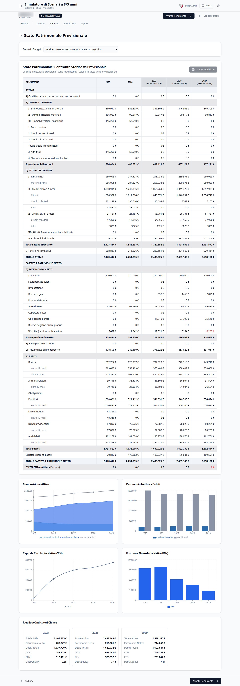

**A che cosa serve.** Lo stesso, per lo stato patrimoniale: le celle di dettaglio si forzano, i
totali e la cassa si ricalcolano («Le celle di dettaglio previsionali sono modificabili; i
totali e la cassa vengono ricalcolati»).

**Che cosa c'è a schermo.** La griglia SP storico vs previsionale e la stessa cassa che chiude il
foglio. Le modifiche si applicano con **«Salva modifiche»**; **«Ripristina tutte le forzature»**
le toglie in blocco. I controlli che il motore fa valere:

- Le righe **governate da un piano** (il pregresso che il passo 5 scadenzi) si **rifiutano**:
  l'override sopravviverebbe un anno e poi il piano lo cancellerebbe, con la cassa che assorbe
  la differenza senza alcun flusso. Il messaggio nomina la voce e il passo del wizard che la
  scadenzia; la via d'uscita è svuotare la cella.
- Un override **negativo** su una cella dello SP diventa uno **zero** senza lamentarsi (salvo
  l'utile e la riserva negativa per azioni proprie, che possono essere negativi).
- Le righe **a giorni** (DSO/DPO) valgono **un anno solo**: dall'anno dopo tornano alla formula.
- Un override che squilibra il foglio **non** si chiude con cassa a zero: il fabbisogno viene
  misurato dopo l'override e, se lo scoperto non è concesso, la generazione viene rifiutata.

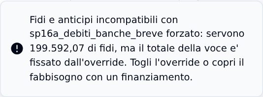

**Esempio.** Forzare a 0 il debito bancario a breve 2027, quando il piano prevede 199.592,07 €
di prelievo dai fidi, produce il rifiuto nella figura: l'override non viene salvato e il
foglio resta com'era. La via d'uscita è nel messaggio stesso (togli l'override, o finanzia il
fabbisogno).

## 11. Rendiconto

`/cashflow`

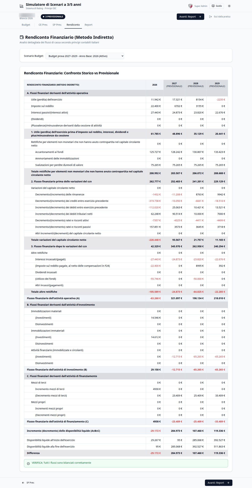

**Che cosa c'è a schermo.** Il rendiconto finanziario **metodo indiretto** (OIC): A. flussi
dall'attività operativa, B. attività di investimento, C. attività di finanziamento, e
«Incremento (decremento) delle disponibilità liquide (A±B±C)», storico contro previsionale, con il controllo in fondo
(«Tutti i flussi sono bilanciati correttamente» — è un controllo, non una cortesia).

**Due scelte che si vedono nei numeri**

- Le **erogazioni** (finanziamenti nuovi, incluso il prelievo dai fidi) stanno in una riga,
  «Incremento mezzi di terzi», separata dai **rimborsi**, «(Decremento mezzi di terzi)»: il DSCR
  può usare la sola quota capitale contrattuale.
- Il debito finanziario **non passa dal circolante**: le variazioni dei debiti vanno in
  finanziamento, e il circolante prende gli aggregati al netto delle quote finanziarie.

**Esempio (figura).** 2027: l'operativo porta **+178.346 €**, gli investimenti −150.000 €
(«(Investimenti)» nella sezione B), il finanziamento **+106.591 €** (incremento mezzi di terzi
− rimborsi): **+134.937 €** di incremento, che sommati ai 55 € d'apertura chiudono a
**134.991 €** di disponibilità liquide. Il «VERIFICA» in fondo è esattamente questo conto.

**Approfondisci** → [FORECASTING_GUIDE.md](budget/FORECASTING_GUIDE.md)

## 12. Report — il Business plan

`/report`

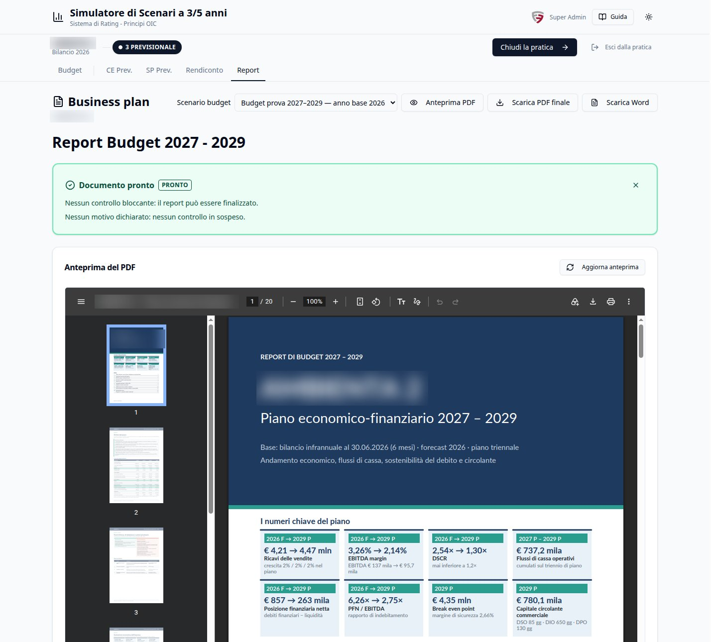

**A che cosa serve.** Il documento da consegnare: un PDF generato dal server (non
dalla pagina del browser) con copertina, indice e dieci sezioni — Sintesi del piano · Evoluzione
economica dell'impresa · EBITDA margin e struttura dei costi · Costi fissi e variabili · break
even point · Flussi di cassa · Sostenibilità del debito · DSCR e PFN · Capitale circolante
commerciale · Solidità patrimoniale, liquidità e redditività · Punto di partenza · Assunzioni
del piano — più gli **Allegati A–E** (conto economico, stato patrimoniale e rendiconto
completi, indicatori di sintesi, indici analitici). Le pagine crescono con l'orizzonte del
piano: un 5 anni ne conta una in più dello stesso 3 anni.

**Che cosa c'è a schermo**

- Il selettore «Scenario budget», **«Anteprima PDF»**, **«Scarica PDF finale»** / **«Scarica
  bozza»** a seconda dello stato, **«Scarica Word»**.
- Il banner di stato: **«Documento pronto»**, **«Documento in bozza»** oppure **«Documento
  bloccato»**, con la motivazione (figura sotto). Se il previsionale è più vecchio delle ipotesi,
  un avviso a parte, **«Previsionale da rigenerare»**, ha il pulsante **«Rigenera previsionale»**.
- La scheda **«Anteprima del PDF»**: il documento pagina per pagina, prima di scaricarlo.
- In fondo, il riquadro chiuso **«Vista web del dossier · tabelle e grafici per sezione»**: le
  tabelle del vecchio dossier (fonti, rettifiche, conto economico, stato patrimoniale, flussi,
  indicatori e rischi). Non è il Business plan: per i numeri da consegnare fa fede il PDF. Serve
  per la tracciabilità: la sezione Fonti dà ogni fonte con numero di revisione e data, così un
  numero si può sempre riportare al file che l'ha prodotto.

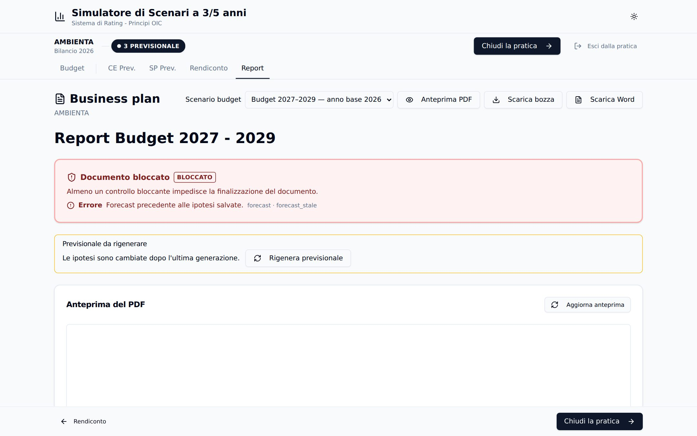

**Attenzione a.** Finché un controllo bloccante non si risolve il pulsante resta «Scarica
bozza»: la bozza ha gli stessi numeri, ma il documento dice di essere bozza.

**Formule** → [Le formule dei report › Il Business plan](#il-business-plan) · [Il break even point](#il-break-even-point)

**Approfondisci** → [BUSINESS-PLAN-PDF.md](budget/BUSINESS-PLAN-PDF.md)

## 13. Il percorso Startup

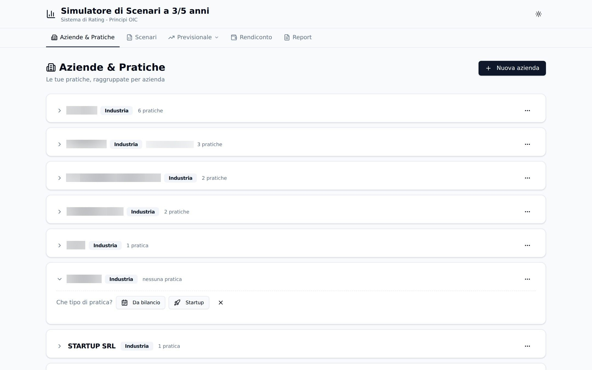

**A che cosa serve.** Fare un business plan **senza bilancio storico**: una start-up parte da
capitale sociale e driver economici.

**Che cosa c'è a schermo**

- «Nuovo business plan startup»: *«Una startup non ha un bilancio storico. Inserisci l'identità,
  il capitale di partenza e i driver economici attesi per ogni anno: le variabili economiche del
  previsionale vengono generate in automatico.»*
- **«Nome startup\*»**, **«Descrizione»**, **«Capitale sociale di partenza (€)\*»** («Conferito
  come liquidità: costituisce il patrimonio netto e la cassa dello stato patrimoniale di
  partenza.»), **«Periodo di piano»** 3/5 anni, e la tabella **«Driver economici attesi per
  anno»**: Ricavi, Margine EBITDA %, Costi del personale, Numero dipendenti; i Costi per servizi
  sono il residuo e l'EBITDA è calcolato.
- **«Crea business plan e continua»**: crea lo scenario e ti porta al wizard, dove inserisci
  investimenti, finanziamenti e le altre variabili patrimoniali («Business plan creato! Completa
  le variabili patrimoniali.»).

Dalla stessa scheda azienda della home: «Nuova pratica» → **Startup**. In alto lo stepper mostra
solo le fasi vere (1 DATI → 3 PREVISIONALE): le ANALISI infrannuale non ci sono, non c'è un
bilancio da confrontare.

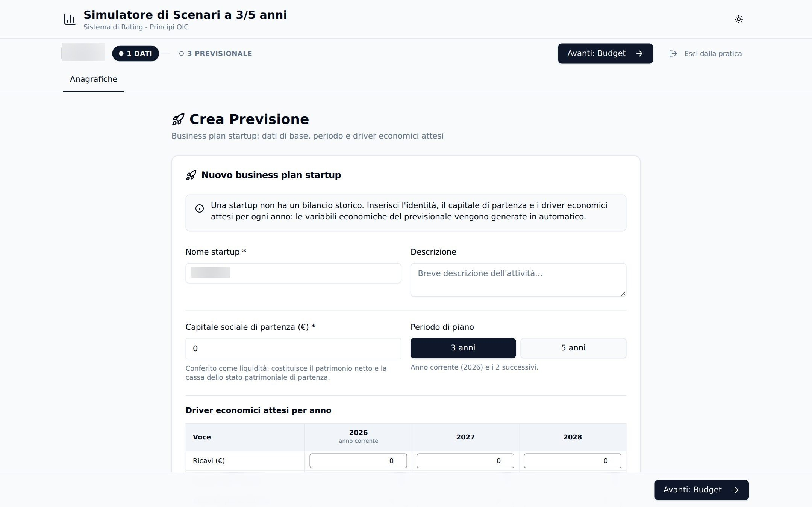

**Attenzione a.** Il percorso Startup **non** ammette rettifiche, non ha anno base da bilancio e
non usa le percentuali del wizard ordinario: è lo stesso motore di previsione, ma alimentato a
driver. Le griglie CE Prev./SP Prev. restano disponibili, con gli stessi override.

---

# I due percorsi completi

## A · Da un bilancio PDF a un Business plan

1. **Home → Nuova azienda** (o espandi la scheda se l'azienda esiste già): nome, partita IVA,
   settore. → «Nuova pratica» → **Da bilancio** (→ «Nuovo bilancio», se l'azienda ha già un
   bilancio annuale: con «Bilancio esistente» → «Crea budget» salti direttamente al punto 7).
2. **Anagrafica**: verifica nome e settore; «Salva e prosegui».
3. **Import**: anno, periodo «12 mesi (31/12)», scegli il PDF e **«Importa e Continua»**.
4. **Rettifiche**: leggi la verifica di quadratura, correggi in partita doppia; **«Conferma e
   vai al Confronto»**. È il gate: niente ANALISI senza. Se il bilancio non quadra puoi confermare lo stesso: l'avviso resta.
5. **Analisi**: Confronto, Indicatori, Stampa. Se hai importato un periodo sotto i 12 mesi,
   compare in più la tab Proiezione.
6. **«Prosegui al Budget»** (in alto a destra nella tab Stampa): crea lo scenario con l'anno base
   che hai importato e apre il wizard al passo 1.
7. I 7 passi del wizard; all'ultimo **«Salva e calcola previsionale»**, e leggi sempre il toast.
   Se il calcolo riesce, l'app passa al CE Previsionale.
8. Controlla **CE Prev.**, **SP Prev.** e **Rendiconto**, poi **Report**: seleziona lo scenario,
   leggi il banner e **«Scarica PDF finale»**; se il pulsante è «Scarica bozza», risolvi prima i
   controlli bloccanti elencati nel banner.

## B · Da un semestrale a un'analisi infrannuale

1. **Home → Nuova pratica → Da bilancio**; **Anagrafica**.
2. **Import** con periodo **«6 mesi (30/06)»**: il parziale coesiste con l'eventuale annuale
   dello stesso anno, non lo sostituisce.
3. **Rettifiche** su entrambe le schede — storico e parziale — e conferma: ciascuna ha il suo
   giornale e il suo tetto di 30 voci.
4. **Confronto**: semestre annualizzato contro l'ultimo anno pieno.
5. **Proiezione**: se serve, aggiusta le righe CE e gli acconti; **«Calcola e vai agli
   Indicatori»** (un fabbisogno scoperto qui esce in diagnosi di errore: lo scenario non è
   promuovibile finché non lo copri).
6. **Indicatori**: spunta i segnali extracontabili e **«Calcola Rating»**. Poi **Stampa**:
   **«Scarica PDF»** — *quello* è il documento, con i testi di commento ai numeri — o **«Scarica
   Word»** per ritoccarli.
7. Se il semestre deve diventare base di un budget: **«Prosegui al Budget»** — promuove la
   proiezione copiandola nel bilancio annuale di quell'anno, **sostituendolo** se era già stato
   importato (è l'unico passo distruttivo del percorso: verifica prima la quadratura), e apre il
   wizard.

---

# Le formule dei report

Ogni numero dei due documenti che si consegnano — il **report infrannuale** della Stampa (§ 7)
e il **Business plan** del Report (§ 12) — si calcola con le formule di questa sezione. I report
non ricalcolano nulla per conto proprio: leggono gli indicatori del server e, al più, sommano o
sottraggono righe già presenti nei prospetti.

**Prima di confrontare i due documenti, leggi le «differenze fra i due report», qui sotto.**
Alcuni indicatori hanno lo stesso nome nei due documenti ma non la stessa formula: lo stesso anno
può avere un DSCR o una PFN diversi nel report infrannuale e nel Business plan, e non è un errore
di nessuno dei due.

## Le grandezze di base (valgono per entrambi)

| Grandezza | Formula |
|---|---|
| **Valore della produzione** | ricavi delle vendite + variazioni delle rimanenze di prodotti + variazioni dei lavori in corso su ordinazione + incrementi di immobilizzazioni per lavori interni + altri ricavi e proventi |
| **Costi operativi** | costi della produzione **esclusi** ammortamenti e svalutazioni (B.10). Gli accantonamenti (B.12, B.13) ci restano dentro |
| **EBITDA (MOL)** | valore della produzione − costi operativi |
| **EBITDA margin** | EBITDA ÷ ricavi delle vendite × 100 |
| **EBIT (risultato operativo)** | EBITDA − ammortamenti e svalutazioni |
| **Risultato ante imposte** | EBIT + proventi finanziari − oneri finanziari ± utili e perdite su cambi ± rettifiche di valore di attività finanziarie ± proventi e oneri straordinari |
| **Utile netto** | risultato ante imposte − imposte sul reddito |
| **Immobilizzazioni** | immateriali + materiali + finanziarie |
| **Patrimonio netto** | capitale + riserve + utile (perdita) dell'esercizio |
| **Capitale circolante commerciale** | crediti verso clienti (entro **e** oltre 12 mesi) + rimanenze − debiti verso fornitori (entro e oltre 12 mesi) |
| **Incidenza di un costo** | costo ÷ ricavi delle vendite × 100 (il denominatore sono i ricavi delle vendite, non il valore della produzione) |
| **Variazione %** | (valore ÷ valore di confronto − 1) × 100; «n.d.» se il valore di confronto è zero |

**«n.d.» non vuol dire zero.** Un indice va a «n.d.» quando il denominatore è zero o negativo,
oppure quando manca il dettaglio che serve: crediti verso clienti, debiti verso fornitori o
debiti finanziari che l'import ha lasciato solo in aggregato. Si corregge integrando il dettaglio
in Rettifiche (§ 3).

## Il report infrannuale

**Le colonne.** **C** è il consuntivo dell'ultimo anno pieno; **6M** (o il numero di mesi del
periodo) è l'infrannuale alla data; **Ann.** è l'annualizzato, che compare solo nel conto
economico e solo se il periodo è parziale; **F** è il forecast a fine anno, che compare solo se
la proiezione è stata generata.

- **Annualizzato** = valore del periodo × 12 ÷ mesi del periodo. Vale solo per le voci di
  conto economico. Lo stato patrimoniale è una fotografia alla data e non si annualizza mai.
- **Forecast** = la proiezione a fine anno costruita con le ipotesi sul resto dell'anno (§ 5).
  Non è l'annualizzato aritmetico.
- **Indicatori della colonna 6M**: lo stato patrimoniale è quello alla data, il conto
  economico è annualizzato. Così ROI, ROE, ROS, EBITDA %, DSCR e PFN/EBITDA si confrontano con un
  anno intero.

**Le grandezze delle sezioni 4-6**

| Voce | Formula |
|---|---|
| Attivo circolante (sez. 4) | rimanenze + crediti entro 12 mesi + crediti oltre 12 mesi + attività finanziarie non immobilizzate + disponibilità liquide |
| Debiti finanziari (sez. 4) | debiti verso banche + altri finanziatori + obbligazioni, entro e oltre 12 mesi |
| Debiti operativi (sez. 4) | debiti verso fornitori + tributari + previdenziali + altri debiti, entro e oltre 12 mesi |
| Capitale circolante netto (sez. 4) | attivo circolante della riga sopra − debiti entro 12 mesi |
| Capitale circolante netto «(indicatore)» (sez. 5) | quello degli indicatori della crisi, nella tabella qui sotto. Il report avverte che le due righe usano aggregazioni diverse |

**I 15 indicatori della crisi d'impresa** (sezioni 6-7; sono gli stessi della tab Indicatori, § 6)

Qui l'**attivo corrente** è rimanenze + crediti entro 12 mesi + attività finanziarie non
immobilizzate + disponibilità liquide + ratei e risconti attivi. Il **passivo corrente** è
fatto dei soli debiti entro 12 mesi.

| Indicatore | Formula |
|---|---|
| **DSCR** | (EBITDA − imposte) ÷ oneri finanziari |
| **EBITDA %** | EBITDA ÷ ricavi delle vendite × 100 |
| **Margine di tesoreria** | attivo corrente − rimanenze − debiti entro 12 mesi |
| **CCN** | attivo corrente − debiti entro 12 mesi |
| **Liquidità corrente** | attivo corrente ÷ debiti entro 12 mesi |
| **Margine di struttura** | patrimonio netto − immobilizzazioni |
| **Copertura immobilizzazioni** | (patrimonio netto + debiti oltre 12 mesi) ÷ immobilizzazioni × 100 |
| **Indipendenza finanziaria** | patrimonio netto ÷ totale attivo × 100 |
| **PFN** | debiti verso banche + obbligazioni (entro e oltre) − disponibilità liquide − attività finanziarie non immobilizzate. I debiti verso altri finanziatori **restano fuori**, esposti a parte nella sezione 6 |
| **PFN / EBITDA** | PFN ÷ EBITDA |
| **ROI** | EBIT ÷ totale attivo × 100 |
| **ROE** | utile netto ÷ patrimonio netto × 100 |
| **ROS** | EBIT ÷ ricavi delle vendite × 100 |
| **Oneri finanziari / MOL** | oneri finanziari ÷ EBITDA × 100 |
| **Oneri finanziari / fatturato** | oneri finanziari ÷ ricavi delle vendite × 100. È solo informativo: non entra nella classe di rischio |

**PFN quando manca il dettaglio dei debiti.** Se i debiti verso banche e le obbligazioni sono
a zero, la PFN si calcola sul totale dei debiti meno quelli non finanziari noti (fornitori,
tributari, previdenziali, altri finanziatori). Se l'import non ha dato nessun dettaglio dei debiti
(bilancio abbreviato), si usa il totale dei debiti.

**Punteggio, esito e classe di rischio.** Ogni indicatore riceve un punteggio da 0 a 1, lineare
fra i due estremi della tabella e fermo a 0 e a 1 fuori da quegli estremi. L'esito di riga
dipende dal punteggio:

- **oltre soglia** sotto 0,33;
- **attenzione** da 0,33 a 0,66;
- **in soglia** da 0,66 in su.

| Indicatore | Su che cosa si misura | Punteggio 0 a | Punteggio 1 a |
|---|---|---|---|
| DSCR | DSCR | 1,0 | 1,5 |
| EBITDA % | EBITDA % | 5% | 20% |
| Margine di tesoreria | (attivo corrente − rimanenze) ÷ debiti entro 12 mesi | 0,8 | 1,3 |
| CCN e Liquidità corrente | attivo corrente ÷ debiti entro 12 mesi | 0,8 | 1,5 |
| Margine di struttura | patrimonio netto ÷ immobilizzazioni × 100 | 50% | 120% |
| Copertura immobilizzazioni | copertura | 80% | 150% |
| Indipendenza finanziaria | indipendenza | 15% | 50% |
| PFN e PFN / EBITDA | PFN / EBITDA | 6 | 0 |
| ROI | ROI | 0% | 12% |
| ROE | ROE | 0% | 12% |
| ROS | ROS | 0% | 10% |
| Oneri finanziari / MOL | oneri / MOL | 30% | 5% |
| Oneri finanziari / fatturato | oneri / fatturato | 5% | 1% |

Quando un indicatore non si può calcolare, il punteggio è 0,5, cioè «non lo so», e a schermo
l'indice è «n.d.». Succede in tre casi:

- **DSCR** senza oneri finanziari;
- **ROE** con patrimonio netto nullo o negativo;
- **oneri finanziari / fatturato** senza ricavi.

Una contraddizione misurata, invece, dà 0. Succede in due casi:

- PFN positiva con EBITDA nullo o negativo dà 0 su **PFN** e **PFN / EBITDA**;
- oneri finanziari con EBITDA nullo o negativo danno 0 su **Oneri finanziari / MOL**.

La **classe di rischio** nasce da due conteggi: gli indicatori oltre soglia, fra i 14 che
concorrono, e i segnali extracontabili attivi (sezione 8). La tabella si legge dall'alto, e vale
la prima riga che corrisponde:

| Indicatori oltre soglia | Segnali attivi | Classe |
|---|---|---|
| 0 | 0 | **A3** · Nessun rischio |
| fino a 2 | 0 | **A2** · Rischio minimo |
| 3 | 0 | **A1** · Rischio basso |
| fino a 5 | 0 | **B3** · Rischio moderato |
| fino a 5 | 1 | **B2** · Rischio significativo |
| fino a 5 | 2 | **B1** · Rischio elevato |
| fino a 6 | fino a 3 | **C3** · Rischio alto |
| 7 | fino a 3 | **C2** · Rischio grave |
| più di 5 | 3 o più | **C1** · Pre-crisi |
| tutti gli altri casi | | **D** · Crisi |

La colonna **C** non ha segnali extracontabili: i segnali riguardano il periodo in corso, non
l'anno chiuso.

## Il Business plan

**Le colonne.** **C** è il consuntivo, **F** il forecast dell'anno di partenza quando il piano
nasce da un infrannuale, **P** gli anni di piano. Ogni colonna è un anno intero: nessun flusso
viene annualizzato.

**Conto economico e costi (sezioni 2-3)**

| Voce | Formula |
|---|---|
| Altri ricavi e variazioni | valore della produzione − ricavi delle vendite |
| Costi operativi (prima di ammortamenti) | totale costi della produzione − ammortamenti e svalutazioni |
| Incidenze | voce ÷ ricavi delle vendite × 100 |

**Costi fissi e variabili, break even point (sezione 4)** → ha una sottosezione propria:
[Il break even point](#il-break-even-point), qui sotto.

**Flussi di cassa (sezione 5 e Allegato C)** — rendiconto con il metodo indiretto:

- flusso operativo (A) = utile prima di imposte, interessi e plusvalenze + rettifiche non monetarie
  (ammortamenti, accantonamenti, svalutazioni) ± variazioni del capitale circolante netto −
  interessi, imposte pagate e utilizzo dei fondi;
- variazione delle disponibilità liquide = A + B (investimenti) + C (finanziamento);
- disponibilità liquide a fine esercizio = quelle a inizio esercizio + la variazione.

Quando il motore dichiara le erogazioni dell'anno, la riga dei mezzi di terzi si divide in
erogazioni e rimborsi; altrimenti resta il saldo netto. I **flussi operativi cumulati** della
copertina sono la somma dei flussi A degli anni di piano.

**Debito e sostenibilità (sezione 6)**

| Indicatore | Formula |
|---|---|
| **PFN** | debiti verso banche + **altri finanziatori** + obbligazioni (entro e oltre) − disponibilità liquide − attività finanziarie non immobilizzate |
| **Debiti finanziari (convenzione PFN)** | PFN + disponibilità liquide |
| **PFN / EBITDA** | PFN ÷ EBITDA; «n.d.» se l'EBITDA non è positivo |
| **DSCR** | (EBITDA − imposte) ÷ (oneri finanziari + **quota capitale delle rate dei piani**) |
| **Oneri finanziari / MOL**, **/ ricavi** | oneri finanziari ÷ EBITDA (o ÷ ricavi delle vendite) × 100 |
| **ROD (costo del denaro)** | oneri finanziari ÷ debito finanziario **medio** fra inizio e fine anno. Si usa la sola fine anno quando manca il bilancio d'inizio o uno dei due non ha il dettaglio dei debiti |

**La quota capitale del DSCR.** Negli anni di piano comprende solo le rate di un piano di rimborso
vero:

- contratti bancari;
- debito bancario pregresso con un piano in anni;
- altri finanziatori.

Non vi entrano mai il rientro di uno scoperto o di un fido, né i rimborsi anticipati fatti con la
cassa in eccesso. Nella colonna di partenza la quota è il rimborso di debito finanziario letto dal
rendiconto. Il DSCR va a «n.d.» quando quel rendiconto non c'è, per esempio sulla prima colonna
storica, e quando un anno di piano non dichiara le rate.

**PFN, PFN / EBITDA e ROD vanno a «n.d.»** quando i debiti ci sono ma l'import non li ha divisi
fra banche, altri finanziatori e obbligazioni. Dichiarare «PFN = − cassa» sarebbe un numero
inventato.

**Capitale circolante (sezione 7)** — giorni su un anno commerciale di 360 giorni, calcolati sui
saldi di fine anno.

| Indicatore | Formula |
|---|---|
| **DSO** — giorni di credito | 360 × crediti verso clienti (entro e oltre 12 mesi) ÷ ricavi delle vendite |
| **DIO** — giorni di magazzino | 360 × rimanenze ÷ consumo di materie (acquisti + variazione delle rimanenze di materie); «n.d.» con consumo non positivo, frequente nelle aziende di servizi |
| **DPO** — giorni di debito | 360 × debiti verso fornitori (entro e oltre 12 mesi) ÷ (materie + servizi); se non ci sono acquisti, ÷ ricavi |
| **Ciclo di conversione del denaro** | DIO + DSO − DPO |

I giorni che il report misura qui non sono sempre quelli digitati nel passo 4 del wizard. Il
wizard tiene in due gruppi i giorni di magazzino, e i saldi di bilancio comprendono l'IVA mentre
ricavi e acquisti no. La sezione 10 del report lo ricorda.

**Solidità, liquidità e redditività (sezione 8 e Allegato D)**

Qui l'**attivo corrente** è rimanenze + crediti entro 12 mesi + attività finanziarie non
immobilizzate + disponibilità liquide + ratei e risconti attivi. Il **passivo corrente** è
debiti entro 12 mesi + **ratei e risconti passivi**.

| Indicatore | Formula |
|---|---|
| **Altre attività** | totale attivo − (immobilizzazioni + rimanenze + crediti commerciali + disponibilità liquide) |
| **Altre passività** | totale attivo − (patrimonio netto + debiti finanziari) |
| **CCN** | attivo corrente − passivo corrente |
| **Margine di tesoreria** | attivo corrente − rimanenze − passivo corrente |
| **Margine di struttura** | patrimonio netto − immobilizzazioni |
| **Liquidità corrente** | attivo corrente ÷ passivo corrente |
| **Liquidità immediata** | (attivo corrente − rimanenze) ÷ passivo corrente |
| **Indipendenza finanziaria** | patrimonio netto ÷ totale attivo × 100 |
| **Copertura immobilizzazioni** | (patrimonio netto + debiti oltre 12 mesi + **TFR**) ÷ immobilizzazioni × 100 |
| **ROI** | EBIT ÷ totale attivo × 100 |
| **ROE** | utile netto ÷ patrimonio netto × 100; «n.d.» con patrimonio netto negativo |
| **ROS** | EBIT ÷ ricavi delle vendite × 100 |
| **Spread (ROI − ROD)** | ROI − ROD |

**Allegato D**: i 15 indicatori della pratica, con le formule della tabella sopra e il DSCR della
sezione 6. Quando la colonna di partenza è un periodo parziale si aggiungono due righe
annualizzate:

- **ROI (annualizzato)** = ROI del periodo × 12 ÷ mesi;
- **PFN / EBITDA (annualizzato)** = PFN / EBITDA del periodo × mesi ÷ 12.

**Allegato E — indici analitici**

| Indice | Formula |
|---|---|
| Current Ratio (ILC) | attivo corrente ÷ passivo corrente, come nella sezione 8 |
| Quick Ratio (ISL) | (attivo corrente − rimanenze) ÷ passivo corrente |
| Acid Test | (crediti entro e oltre 12 mesi + attività finanziarie + disponibilità liquide) ÷ debiti entro 12 mesi |
| Autonomia finanziaria | patrimonio netto ÷ totale attivo |
| Indice di indebitamento, Debiti / Patrimonio netto | debiti totali ÷ patrimonio netto |
| Debiti / Valore della produzione | debiti totali ÷ valore della produzione |
| ROD (costo del denaro) | come nella sezione 6 |
| (CN+PF+TFR)/AF | (patrimonio netto + debiti oltre 12 mesi + TFR) ÷ immobilizzazioni |
| CN/AF | patrimonio netto ÷ immobilizzazioni |
| CN/(PC+PF) | patrimonio netto ÷ debiti totali |
| Giorni magazzino, credito, debito, ciclo di conversione | come nella sezione 7 |
| Rotazione attivo | ricavi delle vendite ÷ totale attivo |
| Spread (ROI − ROD) | ROI − ROD |
| Leva finanziaria | totale attivo ÷ patrimonio netto |
| MOL / Ricavi, OF / Ricavi | EBITDA (oneri finanziari) ÷ ricavi delle vendite |
| Ricavi / Costo personale, Ricavi / Costo materie | ricavi delle vendite ÷ costo del personale (÷ materie prime) |

ROE, ROI, ROS ed EBITDA margin non si ripetono nell'Allegato E: sono già nell'Allegato D.
Lo Z-Score di Altman e il rating FGPMI non sono nel Business plan.

## Il break even point

Il **break even point** (punto di pareggio) è il fatturato al quale l'**EBITDA vale zero**: i
ricavi delle vendite bastano a coprire i costi variabili e i costi fissi, e non avanza nulla. Il
**margine di sicurezza** dice di quanto possono scendere i ricavi, con gli stessi costi fissi e
la stessa incidenza dei costi variabili, prima di arrivare a quel punto.

Si calcola **solo nel Business plan**: il report infrannuale non ha né il break even point né il
margine di sicurezza.

**Il pareggio è sull'EBITDA, non sull'utile.** Ammortamenti, oneri finanziari e imposte stanno
fuori dal calcolo. Al fatturato di pareggio l'EBITDA è zero, ma l'utile è negativo di
ammortamenti, interessi e imposte. Per un pareggio sull'utile netto servirebbe un fatturato più
alto.

**Dove compare nel Business plan**

- **Copertina**: il riquadro «Break even point» dell'ultimo anno di piano, col suo margine di
  sicurezza.
- **Sintesi (sezione 1)**:
  - il punto chiave «Sopra il break even point» o «Sotto il break even point», secondo il margine
    di sicurezza dell'ultimo anno;
  - le righe «Break even point» e «Margine di sicurezza» del cruscotto;
  - fra i punti di debolezza, «Punto di partenza sotto il break even point» quando la colonna di
    partenza (C o F) ha un margine di sicurezza negativo. In quel caso fra le azioni prioritarie
    compare anche «Superare stabilmente il break even point».
- **Sezione 4 «Costi fissi e variabili · break even point»**:
  - quattro riquadri: costi fissi, margine di contribuzione, break even point e margine di
    sicurezza dell'ultimo anno, ognuno confrontato con la colonna di partenza;
  - il grafico e la tabella anno per anno.

**Le formule**

| Voce | Formula |
|---|---|
| **Costi variabili** | quota variabile del consumo di materie + quota variabile dei servizi |
| **Costi fissi** | quota fissa del consumo di materie + quota fissa dei servizi + godimento di beni di terzi + personale + oneri diversi di gestione + accantonamenti − altri ricavi − variazione delle rimanenze di prodotti − variazione dei lavori in corso su ordinazione − incrementi di immobilizzazioni per lavori interni |
| **Margine di contribuzione** | ricavi delle vendite − costi variabili (in euro) |
| **Margine di contribuzione %** | margine di contribuzione ÷ ricavi delle vendite |
| **Break even point** | costi fissi ÷ margine di contribuzione % |
| **Margine di sicurezza** | (ricavi delle vendite − break even point) ÷ ricavi delle vendite × 100 |

Il **consumo di materie** è la somma di acquisti e variazione delle rimanenze di materie: si
divide in fisso e variabile il consumo, non gli acquisti. Personale, godimento di beni di terzi,
oneri diversi e accantonamenti sono **interamente fissi**.

Gli altri ricavi, le variazioni delle rimanenze di prodotti e dei lavori in corso e gli
incrementi per lavori interni **riducono** i costi fissi: senza, il pareggio non tornerebbe
sull'EBITDA, che li comprende. Per lo stesso motivo i costi fissi del report possono essere più
bassi della somma delle sole voci di costo.

**Da dove vengono le quote fisse e variabili**

- **Anni di piano (P)**: dal motore. Al passo 3 del wizard scegli la **% fissa** di materie e di
  servizi. Poi la parte variabile cresce coi ricavi, più lo scostamento che hai indicato. La parte
  fissa cresce con la sua percentuale, di solito l'inflazione.
- **Colonna di partenza (C o F)**: le stesse formule, con le % fisse del **primo** anno di piano,
  così le colonne restano confrontabili.
- **Senza ipotesi di piano salvate**: 40% fisso e 60% variabile, solo su materie e servizi.

**Esempio (numeri inventati).**

| Voce | € |
|---|---|
| Ricavi delle vendite | 1.000.000 |
| Altri ricavi | 20.000 |
| Consumo di materie, quota fissa 40% | 400.000 → 160.000 fissi · 240.000 variabili |
| Servizi, quota fissa 40% | 200.000 → 80.000 fissi · 120.000 variabili |
| Godimento di beni di terzi | 30.000 |
| Personale | 250.000 |
| Oneri diversi di gestione | 10.000 |

- **Costi variabili** = 240.000 + 120.000 = **360.000**.
- **Margine di contribuzione** = 1.000.000 − 360.000 = **640.000**, cioè il **64%** dei ricavi.
- **Costi fissi** = 160.000 + 80.000 + 30.000 + 250.000 + 10.000 − 20.000 = **510.000**.
- **Break even point** = 510.000 ÷ 0,64 = **796.875**.
- **Margine di sicurezza** = (1.000.000 − 796.875) ÷ 1.000.000 = **20,31%**: i ricavi possono
  scendere di 203.125 € prima che l'EBITDA vada a zero.

**La verifica.** L'EBITDA è 1.020.000 di valore della produzione meno 890.000 di costi operativi,
cioè 130.000. Lo stesso numero esce dal pareggio: (1.000.000 − 796.875) × 64% = 130.000. Con
queste formule (ricavi − break even point) × margine di contribuzione % è **sempre** uguale
all'EBITDA. Se nel tuo report non torna, una delle voci è «n.d.».

**La leva del passo 3.** Una % fissa più alta sposta costi dai variabili ai fissi. Sale il
margine di contribuzione %, e insieme salgono i costi fissi. L'EBITDA non cambia, ma cambia il
pareggio. Con molti costi fissi l'impresa guadagna di più quando i ricavi crescono, ma perde
anche di più quando calano. Quale % è giusta lo decide chi conosce l'impresa: il report applica
quella scelta.

**Quando compare «n.d.»**

- **Materie o servizi forzati a mano in CE Prev.** In quell'anno la divisione fra fisso e
  variabile non esiste più, e tutta la riga del pareggio è «n.d.».
- **Ricavi a zero, o costi variabili pari o superiori ai ricavi.** Il margine di contribuzione non
  è positivo e il pareggio non esiste. Costi fissi e variabili restano scritti; break even point e
  margine di sicurezza sono «n.d.».
- **Scenario generato da una versione precedente del motore.** Il report è comunque in bozza
  «da rigenerare»: rigenera il previsionale.

## Le differenze fra i due report

Questi indicatori portano lo stesso nome nei due documenti ma si calcolano in modo diverso:

| Indicatore | Report infrannuale | Business plan |
|---|---|---|
| **DSCR** | (EBITDA − imposte) ÷ **oneri finanziari** | (EBITDA − imposte) ÷ (oneri finanziari **+ quota capitale delle rate**) |
| **PFN** | banche + obbligazioni − liquidità − attività finanziarie | banche + **altri finanziatori** + obbligazioni − liquidità − attività finanziarie |
| **PFN senza dettaglio dei debiti** | ricostruita dal totale dei debiti | «n.d.» |
| **Liquidità corrente, CCN, margine di tesoreria** | passivo corrente = debiti entro 12 mesi | passivo corrente = debiti entro 12 mesi **+ ratei e risconti passivi** |
| **Copertura immobilizzazioni** | (PN + debiti oltre 12 mesi) ÷ immobilizzazioni | (PN + debiti oltre 12 mesi **+ TFR**) ÷ immobilizzazioni |

**Che cosa vuol dire in pratica.** Quando un budget parte da un infrannuale, la colonna «F» del
Business plan e la colonna «F» del report infrannuale descrivono lo stesso anno. Su un'azienda con
rate da rimborsare, con debiti verso altri finanziatori, con ratei passivi o con TFR, questi
indicatori danno numeri diversi nei due documenti. Ciascun documento è coerente con sé stesso: per
confrontare i due, guarda le formule qui sopra.

---

# Glossario

| Termine | Una riga |
|---|---|
| **Anno base** | L'ultimo bilancio annuale consuntivo da cui il previsionale parte. |
| **Scenario / Budget** | La copia «cosa succede se» del bilancio: un set di ipotesi su N anni. |
| **Pregresso** | Ciò che sta già in bilancio al 31/12 dell'anno base (debiti residui, crediti oltre anno) e va scadenziato. |
| **Override / cella forzata** | Un importo fissato a mano che vince sulla percentuale di crescita e sopravvive ai salvataggi. |
| **DSO** | Giorni medi di incasso dei crediti commerciali (360 giorni, clienti, non crediti generici). |
| **DIO** | Giorni medi di magazzino; in due gruppi: materie/semilavorati sul consumo, finito/merci sui ricavi. |
| **DPO** | Giorni medi di pagamento dei debiti commerciali. |
| **MOL (EBITDA)** | Margine operativo lordo = utile operativo + ammortamenti. |
| **EBIT (RO)** | Risultato operativo, prima dei finanziari. |
| **PFN** | Posizione finanziaria netta = debiti finanziari − liquidità. Il perimetro dei debiti finanziari cambia fra i due report: vedi [Le formule dei report](#le-differenze-fra-i-due-report). |
| **CCN** | Capitale circolante netto = attivo corrente − passivo corrente. |
| **DSCR** | Nel Business plan: (MOL − imposte) ÷ (oneri finanziari + quota capitale delle rate dei piani). Nel report infrannuale: (MOL − imposte) ÷ oneri finanziari. |
| **Break even point** | Il fatturato al quale l'EBITDA vale zero, calcolato dalle quote fisse/variabili dei costi di piano; solo nel Business plan → [Il break even point](#il-break-even-point). |
| **Infrannuale** | Periodo parziale (1-11 mesi) proiettato a 12 contro l'ultimo anno pieno. |
| **Quadratura** | Attivo = passivo (tolleranza 0,01 €) e CE coerente con l'utile in SP. |

---

# Che cosa succede quando qualcosa non torna

| Segnale a schermo | Significato | Cosa fare |
|---|---|---|
| *«Fabbisogno finanziario scoperto di …: aggiungi un'ipotesi di finanziamento esplicita; nessun debito bancario è stato creato automaticamente.»* | Le ipotesi producono cassa negativa e lo scoperto non è concesso | passi 5/6: finanzia davvero (prestito nuovo, fido, o — senza fidi — concedi lo scoperto), o riallinea le ipotesi |
| Toast che nomina una ragione e colonne «(Previsionale)» vuote | Il salvataggio è riuscito ma il previsionale è stato **rifiutato** (risponde «ok» comunque) | il toast dice la ragione e il wizard ti riporta al passo che l'ha causata; correggi lì e salva di nuovo |
| *«Previsionale calcolato»* | Salvataggio e generazione riusciti | — |
| *«Documento bloccato · Forecast precedente alle ipotesi salvate.»* | Hai cambiato le ipotesi dopo l'ultima generazione | «Rigenera previsionale» nell'avviso giallo «Previsionale da rigenerare» |
| *«Fidi e anticipi incompatibili con … forzato: servono … di fidi, ma il totale della voce è fissato dall'override.»* | Un override SP pretende una cassa che il piano dei fidi non può fare | togli l'override o copri il fabbisogno con un finanziamento (passo 5/6) |
| *«Massimo 30 rettifiche. Eliminane qualcuna per aggiungerne altre.»* | Il tetto del giornale di quell'anno | elimina rettifiche obsolete o raggruppale |
| **«n.d.»** su un indice | Denominatore non positivo, o dettaglio (crediti commerciali, debito finanziario) che l'import non ha mai classificato | integra il dettaglio in Rettifiche: non è un guasto, è il dato che manca |
| Riga con delta pari a **2× l'importo** in Confronto/CE | una riga di costo è stata letta nella colonna dei ricavi (o viceversa) | rettifica di **direzione**, non di importo |
| **«Pratica da riaprire»** | Dopo l'aggiornamento della pagina la pratica infrannuale non si ritrova più (per esempio azienda o anno cambiati altrove) | riparti dall'importazione, o riapri la pratica dalla home con «Riprendi»: i dati salvati restano |

---

# Dove andare dopo

- Aritmetica del motore budget → [docs/budget/FORECASTING_GUIDE.md](budget/FORECASTING_GUIDE.md)
- Contratti API (corpi, precedenze, cosa azzera cosa) → [docs/budget/API-PREVISIONALE.md](budget/API-PREVISIONALE.md)
- Percorso, gate e stepper → [docs/frontend/PRATICA-PERCORSO.md](frontend/PRATICA-PERCORSO.md)
- Giornale delle rettifiche → [docs/frontend/RETTIFICHE.md](frontend/RETTIFICHE.md)
- Import: routing, estrazione, quadrature → [docs/import/REGOLE-IMPORT-00-INDICE.md](import/REGOLE-IMPORT-00-INDICE.md)
- Business plan e report infrannuale → [docs/budget/BUSINESS-PLAN-PDF.md](budget/BUSINESS-PLAN-PDF.md), [docs/budget/REPORT-INFRANNUALE-PDF.md](budget/REPORT-INFRANNUALE-PDF.md)
